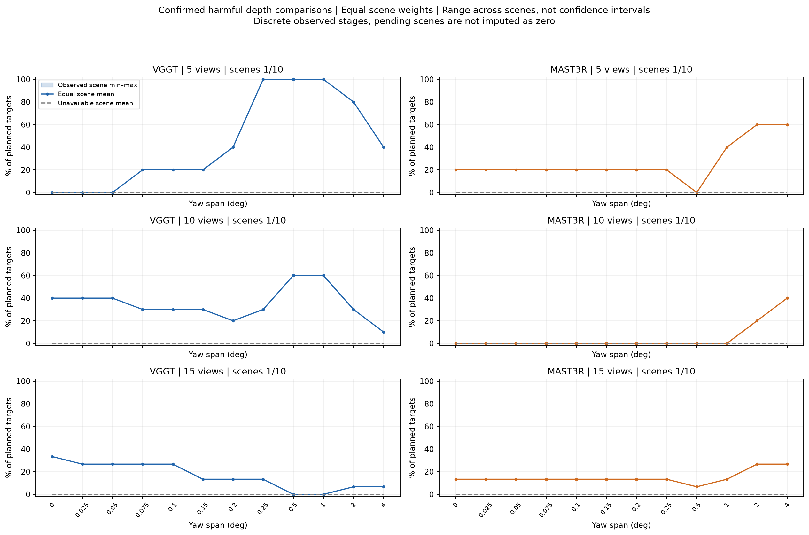
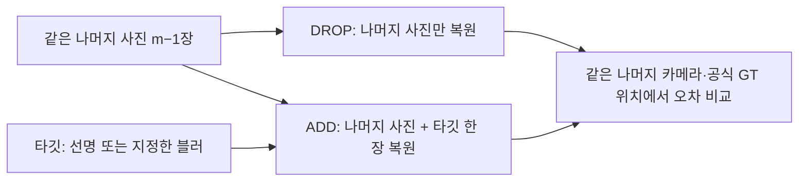

# FrameUtility 공통 분석 보고서

분석 버전 **1.0.0**. 요청 범위: **courtyard, electro, facade, kicker, meadow, office, relief, relief_2, terrace, terrains**. 숫자 집계에 사용한 장면: **office**.

**질문:** 흐린 사진 한 장을 추가하는 것이 그 사진을 뺀 것보다 언제 나빠지는가? 주 지표는 공식 GT 공통 격자의 깊이 AbsRel이고 U=E_DROP−E_ADD다. 양수는 도움, 음수는 손해다.

## 주 분석 장면 전체의 진행 상황

| 장면 | 이번 요청에 포함 | 실행 상태 | 이번 분석에 포함 | 상세 보고서 |
| --- | --- | --- | --- | --- |
| courtyard | 예 | not_started | 아니오 | 대기 |
| electro | 예 | not_started | 아니오 | 대기 |
| facade | 예 | not_started | 아니오 | 대기 |
| kicker | 예 | not_started | 아니오 | 대기 |
| meadow | 예 | not_started | 아니오 | 대기 |
| office | 예 | complete | 예 | [보고서](scenes/office/report.md) |
| relief | 예 | not_started | 아니오 | 대기 |
| relief_2 | 예 | not_started | 아니오 | 대기 |
| terrace | 예 | not_started | 아니오 | 대기 |
| terrains | 예 | not_started | 아니오 | 대기 |

계획된 주 분석 장면은 office를 포함한 10개다. 다른 장면이 없으면 office의 결과만 기술하고, 미계산 장면을 유해율 0으로 넣지 않는다. 요청 범위의 일부만 준비됐을 때도 사용/계획 장면 수를 보이며 전체 완료로 표시하지 않는다.

사전 제외 장면: delivery_area: Official section 6 selection failed: could not reduce the 15-view robust component to 10 while preserving biconnectivity; playground: Official section 6 selection failed: could not reduce the 10-view robust set to 5 while preserving biconnectivity; pipes: 14 calibrated images; fewer than the required 15

## 완료율과 결과의 의미

| 장면 | 모델 | 계획 비교 | 점수 기록 | 깊이 유효 | 포즈 유효 | 5지표 유효 | 실패 포함 | 누락 포함 | 장치 |
| --- | --- | --- | --- | --- | --- | --- | --- | --- | --- |
| office | VGGT | 360 | 360 | 360 | 360 | 360 | 0 | 0 | mps |
| office | MAST3R | 360 | 360 | 360 | 360 | 360 | 0 | 0 | mps |

각 장면의 상세 보고서는 모든 타깃 곡선·실제 오차·문턱 민감도·비정상 깊이·사례·복구 기록을 같은 형식으로 보여준다. 전체 기록이 없어 분석할 수 없는 장면은 상태 표에 남기고, 없는 결과를 추정하거나 보간하지 않는다.

## 장면 동일 가중치 집계

모델·집합 크기·각도별로 각 장면의 계획 타깃 분모에서 유해 비율을 계산한 다음 장면들을 같은 가중치로 평균한다. 아래는 원래 주 문턱을 적용한 clean/마지막 단계다. 표의 중앙값·최솟값·최댓값도 **장면별 유해 비율 사이의 분포**다. 여러 타깃을 한데 모은 값은 CSV의 보조 열로 구분한다.

현재 사용할 수 있는 장면은 1개로, 다중 장면 요약의 최소 5개에 못 미친다. 아래 숫자는 확보된 요청 장면의 기술 통계이며 다중 장면 최종 결론으로 해석하지 않는다.

| 모델 | 크기 | 각도(°) | 사용/요청 장면 | 유해율 장면 평균(%) | 중앙값(%) | 최소–최대(%) | 미평가율 평균(%) |
| --- | --- | --- | --- | --- | --- | --- | --- |
| MAST3R | 5 | 0 | 1/10 | 20.0 | 20.0 | 20.0–20.0 | 0.0 |
| MAST3R | 5 | 4 | 1/10 | 60.0 | 60.0 | 60.0–60.0 | 0.0 |
| MAST3R | 10 | 0 | 1/10 | 0.0 | 0.0 | 0.0–0.0 | 0.0 |
| MAST3R | 10 | 4 | 1/10 | 40.0 | 40.0 | 40.0–40.0 | 0.0 |
| MAST3R | 15 | 0 | 1/10 | 13.3 | 13.3 | 13.3–13.3 | 0.0 |
| MAST3R | 15 | 4 | 1/10 | 26.7 | 26.7 | 26.7–26.7 | 0.0 |
| VGGT | 5 | 0 | 1/10 | 0.0 | 0.0 | 0.0–0.0 | 0.0 |
| VGGT | 5 | 4 | 1/10 | 40.0 | 40.0 | 40.0–40.0 | 0.0 |
| VGGT | 10 | 0 | 1/10 | 40.0 | 40.0 | 40.0–40.0 | 0.0 |
| VGGT | 10 | 4 | 1/10 | 10.0 | 10.0 | 10.0–10.0 | 0.0 |
| VGGT | 15 | 0 | 1/10 | 33.3 | 33.3 | 33.3–33.3 | 0.0 |
| VGGT | 15 | 4 | 1/10 | 6.7 | 6.7 | 6.7–6.7 | 0.0 |



점은 장면별 유해 비율을 같은 가중치로 평균한 값이고 띠는 사용 장면 사이의 최솟값–최댓값이다. 신뢰구간이 아니다. 회색 점선은 평가 불가 비율의 장면 평균이다. 미계산 장면을 0으로 넣지 않으며 사용/요청 장면 수를 각 패널에 표시한다.

`tables/cohort_summary.csv`에는 모든 각도와 다섯 지표, 전체·장치별·실행 그룹별 집계가 있다. 장치별 집계는 장치 효과 실험이 아니며 장면 구성 차이를 함께 가진다. MPS/CUDA의 결론상 동등성은 가정이고 별도 교차 검증하지 않았다. 같은 장면의 두 모델과 ADD/DROP은 같은 플랫폼에서 실행됐는지 입력 검증에서 확인한다.

## 비교 방법과 숫자를 읽는 법

입력 사진 묶음은 5·10·15장이다. 각 묶음에서 타깃 한 장을 고르고, 그 사진을 뺀 나머지 사진으로 공간을 복원한 결과를 DROP이라 한다. 같은 나머지 사진에 타깃을 더한 결과가 ADD다. ADD에서는 타깃 한 장만 흐리게 만들며, 나머지는 항상 선명하다. 채점할 때는 타깃을 제외한 같은 나머지 카메라와 같은 GT 픽셀만 비교한다.



블러 각도는 노출 동안 카메라가 좌우로 돌아가는 전체 yaw 범위다. 원본을 왜곡 보정한 RGB에서 회전 워핑 33장을 선형 sRGB로 적분했고, 준비 영상은 1008×672 픽셀이다. 0도도 같은 처리 경로를 거쳐 선명 영상과 픽셀이 같은지 확인했다. 이는 특정 합성 흔들림 모델이며 실제 동영상의 모든 흐림을 뜻하지 않는다.

주 지표 AbsRel은 예측 깊이와 공식 ETH3D 정답 깊이의 상대 오차를 평균한 값이다. 예를 들어 AbsRel 0.02는 표본 위치의 평균 상대 오차 2%다. 두 모델 모두 같은 252×160 격자·공식 유효 마스크에서 채점한다. 공통 컨텍스트 전체의 유효한 양수 예측으로 GT/예측 비율의 중앙값 한 개를 구해 깊이 스케일을 맞추고, 유한한 0·음수 예측도 그 마스크에서 오차에 넣는다. NaN·Inf는 geometry 평가 불가로 남긴다. 유효 GT 픽셀 수가 많은 사진의 깊이 점수 가중치가 더 크지만 같은 비교에서는 모델·ADD/DROP의 가중치가 같다.

모든 지표의 분석 기여도는 **U = E_DROP − E_ADD**다. 양수는 타깃을 추가해 오차가 줄었다는 뜻, 음수는 오차가 늘었다는 뜻이다. 깊이 U를 표시할 때는 100을 곱해 percentage point(pp)로 쓴다. AbsRel 2.00%에서 1.80%로 줄면 U=+0.20pp다. 이는 상대적으로 10% 감소했다는 표현과 단위가 다르다. 포즈의 저장된 `utility` 열은 상대 변화율이므로 주 분석에 사용하지 않고, `E_DROP`·`E_ADD`의 원래 차이와 `utility_raw`를 대조한다.

깊이의 주 효과 문턱은 ε=0.0005, 즉 0.05pp다. U>+ε는 도움, U<−ε는 해로움, 경계를 포함한 −ε≤U≤+ε는 문턱 이내다. 이 기준은 작은 단일 관측 차이를 분리하는 연구 운영 기준이며 보편적 중요도 기준이나 재실행 안정성의 증명이 아니다. 이전 office 탐색이 기준 선택에 영향을 준 사실을 유지한다. 원시 부호와 미리 정한 문턱 민감도도 함께 제시한다.

포즈는 GT 카메라 중심에 반사를 허용하지 않는 Sim(3) 정렬을 적용한다. 보조 지표는 깊이 RMSE(m), 장면 반경으로 정규화한 위치 ATE, 상대 병진 오차, 상대 회전 오차(도)다. 포즈와 깊이는 독립 평가하며 보조 지표에는 원래 단위와 원시 부호를 쓴다.

타깃별 값의 중앙값·사분위 범위(IQR)는 **서로 다른 타깃 사이의 분포**다. 신뢰구간·반복 측정 오차 막대가 아니다. seed 2026의 단일 실행이며 복구 시도는 새 표본으로 평균하지 않는다. 중첩된 컨텍스트와 같은 clean 재구성을 공유하는 비교는 서로 독립된 반복이 아니다.

각 단계의 주 분모는 계획한 타깃 수 m이다. 도움·해로움·문턱 이내·평가 불가의 합이 100%가 되며, 누락은 평가 불가에 포함하되 원시 표에서 누락과 실패를 구별한다. 유효 타깃만을 분모로 한 유해 비율은 보조 열이다. 장면을 합칠 때는 장면별 비율을 먼저 계산한 뒤 같은 가중치로 평균하고, 장면 평균·중앙값·최솟값·최댓값과 사용 장면 수를 함께 공개한다.

전환은 clean에서 도움을 보인 곡선이 이후 처음 해로움을 보인 **관측 구간**이다. 첫 음수 앞에서 마지막으로 관측된 양수 단계와 첫 음수 단계 사이를 기록한다. 문턱 분석에서는 각각 +ε 초과·−ε 미만을 쓴다. 중간에 문턱 이내·미해결 단계가 있으면 구간 내부를 미확인으로 표시한다. 역전환도 모두 보존하고 단조성이나 선형 보간을 가정하지 않는다. 4도까지 음수를 관측하지 않았다는 사실로 연속 임계값이 4도보다 크다고 단정하지 않는다.

## 이후 장면에도 같은 분석을 적용한다

```sh
.venv/bin/python experiments/run_all.py analyze --scene office
.venv/bin/python experiments/run_all.py analyze --scene courtyard
# 준비된 모든 주 분석 장면을 같은 규칙으로 다시 집계
.venv/bin/python experiments/run_all.py analyze
# 등록된 서버에서도 같은 인터페이스
.venv/bin/python experiments/run_all.py analyze --target cuda-server
```

`--results-root`로 선택한 실행 위치의 결과 루트를 바꿀 수 있다. 분석은 저장된 예측과 공식 GT/RGB snapshot을 읽는 CPU 작업이다. 신경망·CUDA/MPS 추론을 추가하지 않는다. 실제 파일·사진 ID·GT 마스크·설정·점수 재검산이 실패하면 기존 정상 보고서를 교체하지 않고 오류를 낸다.

상위 보고서와 공통 표는 **이번에 요청한 장면 집합**으로 새로 만들어진다. 장면별 보고서는 `scenes/<scene>/`에 보존되므로 다른 장면 하나를 분석해도 앞서 생성한 장면 보고서가 사라지지 않는다. 전체 통합은 scene 옵션 없이 다시 실행한다. 집계는 이전 보고서 숫자를 합치는 대신 매번 원시 결과에서 계산해 분석 버전이 섞이는 것을 막는다.

`analysis_definition.json`은 분석 정의·버전·문턱·분모·전환 규칙을 보존한다. `analysis_manifest.json`은 모든 사용 입력·코드·출력 해시와 라이브러리 버전을 보존하고, `source/`에는 실제 분석 코드를 복사한다. 분석 버그를 고치면 같은 코드로 대상 장면 전체를 다시 분석하고 새로운 분석 해시를 비교한다. 모델 실행 결과는 수정하지 않는다.
