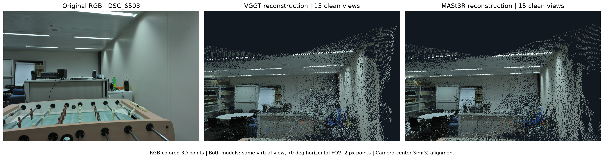
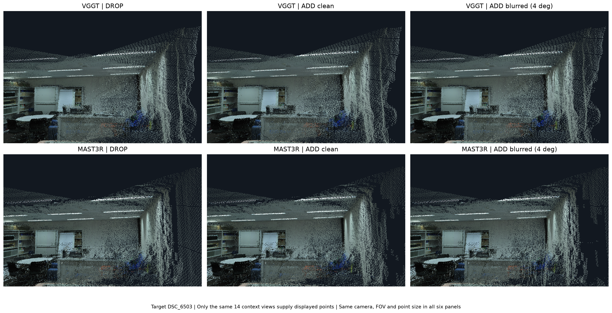
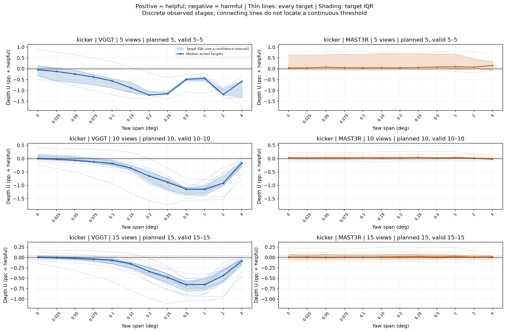
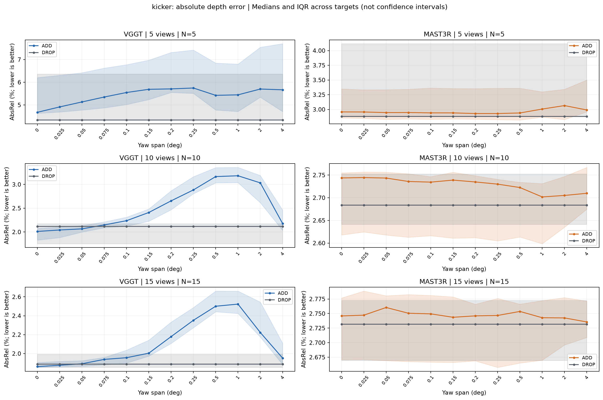
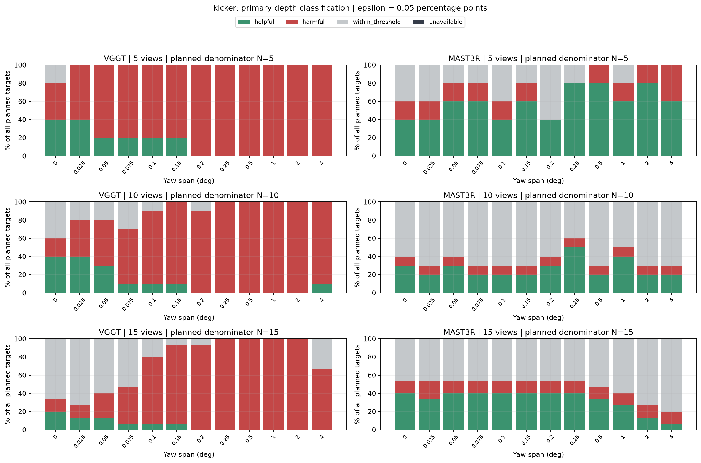
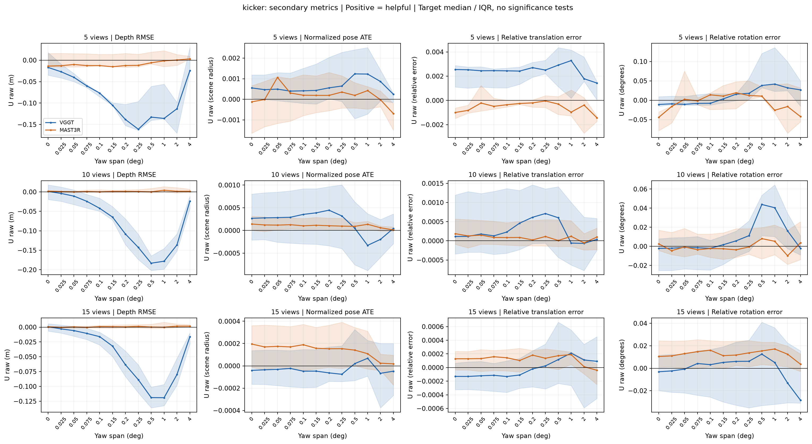
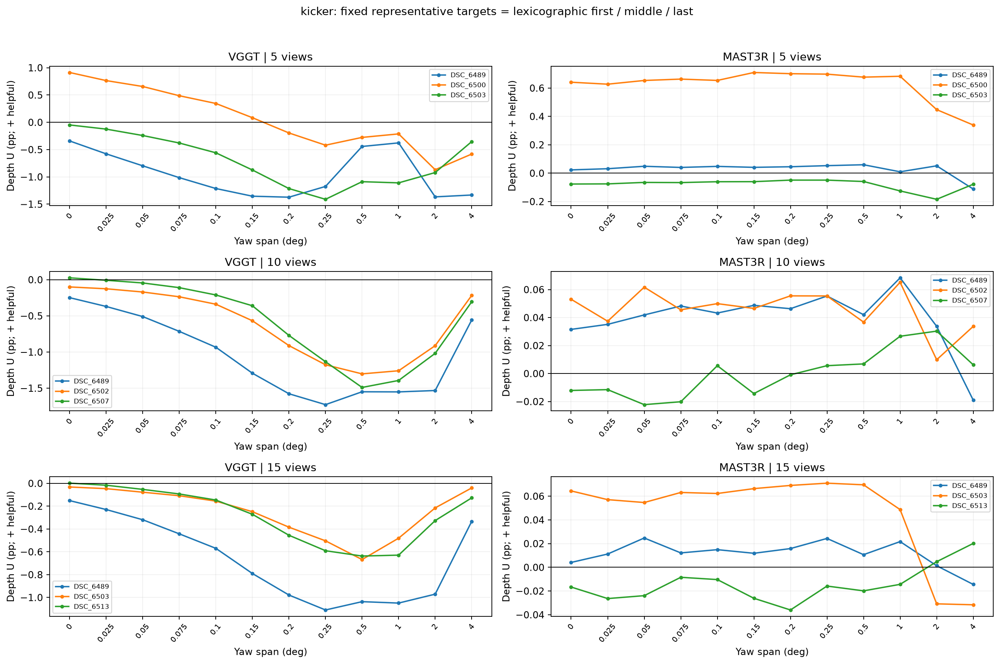
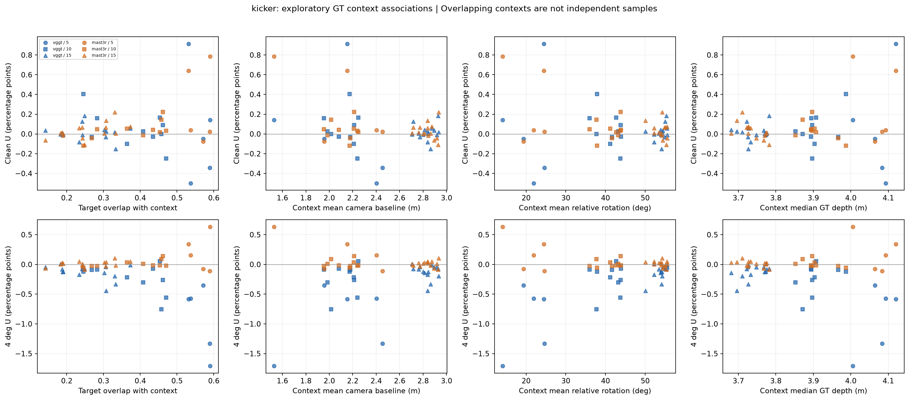

# kicker 실험 분석

**연구 질문:** 여러 사진으로 공간을 복원할 때, 흐린 사진 한 장을 추가하면 그 사진을 뺀 것보다 언제 나빠지는가?

분석 상태: **완료된 장면의 최종 기술 통계**. 실제 장치는 MPS, seed는 2026다. 이 보고서는 kicker 한 장면의 지정된 5·10·15장 집합을 설명한다.

## 먼저 계산 완료 여부를 확인한다

| 장면 | 모델 | 계획 비교 | 점수 기록 있음 | 깊이 2지표 유효 | 포즈 3지표 유효 | 전체 5지표 유효 | 실패 포함 | 누락 포함 | 장치 |
| --- | --- | --- | --- | --- | --- | --- | --- | --- | --- |
| kicker | VGGT | 360 | 360 | 360 | 360 | 360 | 0 | 0 | mps |
| kicker | MAST3R | 360 | 360 | 360 | 360 | 360 | 0 | 0 | mps |

한 비교는 타깃·집합 크기·블러 단계의 조합이다. 모델당 360비교이지만 clean 예측을 여러 타깃에 재사용하므로 별도의 원시 재구성은 모델당 363회다. 첫 표의 유효 수는 저장된 결과를 다시 채점해 확인한 값이다.

## 핵심 관측

- **VGGT**: 30개 타깃·컨텍스트 곡선 중 clean에서 문턱을 넘게 도움을 보인 곡선은 9개, clean부터 해로운 곡선은 6개다. 완전 곡선에서 clean 도움→이후 해로움 전환은 9개, 그 뒤 다시 도움으로 돌아온 곡선은 1개다. 마지막 4도에서 해로운 비교는 24개다.
- **MAST3R**: 30개 타깃·컨텍스트 곡선 중 clean에서 문턱을 넘게 도움을 보인 곡선은 11개, clean부터 해로운 곡선은 4개다. 완전 곡선에서 clean 도움→이후 해로움 전환은 0개, 그 뒤 다시 도움으로 돌아온 곡선은 0개다. 마지막 4도에서 해로운 비교는 5개다.

위의 30개는 5+10+15개 타깃·컨텍스트 조합이며 같은 사진이 여러 집합에 들어갈 수 있다. 30개의 독립 장면이나 반복 표본이라는 뜻이 아니다. 전환 수는 clean부터 유익했던 곡선에서만 센다. 처음부터 해롭거나 문턱 이내였던 곡선은 별도 범주다.

| 모델 | 집합 크기 | clean 유효 | clean 도움 | clean 유해 | 4° 유해 | 도움→유해 전환 수 | clean U 중앙값(pp) | 4° U 중앙값(pp) |
| --- | --- | --- | --- | --- | --- | --- | --- | --- |
| VGGT | 5 | 5/5 | 2/5 | 2/5 | 5/5 | 2 | -0.0482 | -0.5813 |
| VGGT | 10 | 10/10 | 4/10 | 2/10 | 9/10 | 4 | 0.0122 | -0.1682 |
| VGGT | 15 | 15/15 | 3/15 | 2/15 | 10/15 | 3 | 0.0067 | -0.0838 |
| MAST3R | 5 | 5/5 | 2/5 | 1/5 | 2/5 | 0 | 0.0397 | 0.1532 |
| MAST3R | 10 | 10/10 | 3/10 | 1/10 | 1/10 | 0 | 0.0364 | -0.0179 |
| MAST3R | 15 | 15/15 | 6/15 | 2/15 | 2/15 | 0 | 0.0084 | 0.0132 |

전환이 관측되는 사례와 관측되지 않는 사례가 함께 있다. 전환 수를 비교할 때에는 clean부터 도움인 자격 곡선 수가 모델마다 다르다는 점을 함께 봐야 한다. 단순 전환 개수만으로 모델의 블러 취약성 순위를 정하지 않는다. U가 커지는 것과 모델의 절대 깊이 오차가 작다는 것도 별도로 판단한다.

- VGGT 5장: 타깃 U 중앙값은 0.2도에서 -1.2139pp였고, 마지막 4도에서 -0.5813pp로 올라왔다. 이는 이산 단계에서 관측한 비단조 변화이며, 중앙값을 만드는 타깃이 단계마다 같다는 뜻은 아니다.
- VGGT 10장: 타깃 U 중앙값은 1도에서 -1.1499pp였고, 마지막 4도에서 -0.1682pp로 올라왔다. 이는 이산 단계에서 관측한 비단조 변화이며, 중앙값을 만드는 타깃이 단계마다 같다는 뜻은 아니다.
- VGGT 15장: 타깃 U 중앙값은 0.5도에서 -0.6545pp였고, 마지막 4도에서 -0.0838pp로 올라왔다. 이는 이산 단계에서 관측한 비단조 변화이며, 중앙값을 만드는 타깃이 단계마다 같다는 뜻은 아니다.
- MAST3R 5장: 타깃 U 중앙값은 0도에서 0.0397pp였고, 마지막 4도에서 0.1532pp로 올라왔다. 이는 이산 단계에서 관측한 비단조 변화이며, 중앙값을 만드는 타깃이 단계마다 같다는 뜻은 아니다.
- MAST3R 15장: 타깃 U 중앙값은 0.05도에서 0.0013pp였고, 마지막 4도에서 0.0132pp로 올라왔다. 이는 이산 단계에서 관측한 비단조 변화이며, 중앙값을 만드는 타깃이 단계마다 같다는 뜻은 아니다.

위 비교는 흐린 타깃 자체를 채점하지 않고 나머지 공통 컨텍스트에 미친 영향을 본다. 강한 블러에서 U가 회복되더라도 흐린 사진 자체나 전체 3D 복원이 좋아졌다고 해석하지 않는다. 모델이 타깃을 덜 사용했는지, 정렬이나 출력이 달라졌는지 등의 원인은 이번 점수만으로 확인할 수 없다. 공통 임계각이나 단조 악화도 가정하지 않는다.

## 비교 방법과 숫자를 읽는 법

입력 사진 묶음은 5·10·15장이다. 각 묶음에서 타깃 한 장을 고르고, 그 사진을 뺀 나머지 사진으로 공간을 복원한 결과를 DROP이라 한다. 같은 나머지 사진에 타깃을 더한 결과가 ADD다. ADD에서는 타깃 한 장만 흐리게 만들며, 나머지는 항상 선명하다. 채점할 때는 타깃을 제외한 같은 나머지 카메라와 같은 GT 픽셀만 비교한다.


블러 각도는 노출 동안 카메라가 좌우로 돌아가는 전체 yaw 범위다. 원본을 왜곡 보정한 RGB에서 회전 워핑 33장을 선형 sRGB로 적분했고, 준비 영상은 1008×672 픽셀이다. 0도도 같은 처리 경로를 거쳐 선명 영상과 픽셀이 같은지 확인했다. 이는 특정 합성 흔들림 모델이며 실제 동영상의 모든 흐림을 뜻하지 않는다.

주 지표 AbsRel은 예측 깊이와 공식 ETH3D 정답 깊이의 상대 오차를 평균한 값이다. 예를 들어 AbsRel 0.02는 표본 위치의 평균 상대 오차 2%다. 두 모델 모두 같은 252×160 격자·공식 유효 마스크에서 채점한다. 공통 컨텍스트 전체의 유효한 양수 예측으로 GT/예측 비율의 중앙값 한 개를 구해 깊이 스케일을 맞추고, 유한한 0·음수 예측도 그 마스크에서 오차에 넣는다. NaN·Inf는 geometry 평가 불가로 남긴다. 유효 GT 픽셀 수가 많은 사진의 깊이 점수 가중치가 더 크지만 같은 비교에서는 모델·ADD/DROP의 가중치가 같다.

모든 지표의 분석 기여도는 **U = E_DROP − E_ADD**다. 양수는 타깃을 추가해 오차가 줄었다는 뜻, 음수는 오차가 늘었다는 뜻이다. 깊이 U를 표시할 때는 100을 곱해 percentage point(pp)로 쓴다. AbsRel 2.00%에서 1.80%로 줄면 U=+0.20pp다. 이는 상대적으로 10% 감소했다는 표현과 단위가 다르다. 포즈의 저장된 `utility` 열은 상대 변화율이므로 주 분석에 사용하지 않고, `E_DROP`·`E_ADD`의 원래 차이와 `utility_raw`를 대조한다.

깊이의 주 효과 문턱은 ε=0.0005, 즉 0.05pp다. U>+ε는 도움, U<−ε는 해로움, 경계를 포함한 −ε≤U≤+ε는 문턱 이내다. 이 기준은 작은 단일 관측 차이를 분리하는 연구 운영 기준이며 보편적 중요도 기준이나 재실행 안정성의 증명이 아니다. 이전 office 탐색이 기준 선택에 영향을 준 사실을 유지한다. 원시 부호와 미리 정한 문턱 민감도도 함께 제시한다.

포즈는 GT 카메라 중심에 반사를 허용하지 않는 Sim(3) 정렬을 적용한다. 보조 지표는 깊이 RMSE(m), 장면 반경으로 정규화한 위치 ATE, 상대 병진 오차, 상대 회전 오차(도)다. 포즈와 깊이는 독립 평가하며 보조 지표에는 원래 단위와 원시 부호를 쓴다.

타깃별 값의 중앙값·사분위 범위(IQR)는 **서로 다른 타깃 사이의 분포**다. 신뢰구간·반복 측정 오차 막대가 아니다. seed 2026의 단일 실행이며 복구 시도는 새 표본으로 평균하지 않는다. 중첩된 컨텍스트와 같은 clean 재구성을 공유하는 비교는 서로 독립된 반복이 아니다.

각 단계의 주 분모는 계획한 타깃 수 m이다. 도움·해로움·문턱 이내·평가 불가의 합이 100%가 되며, 누락은 평가 불가에 포함하되 원시 표에서 누락과 실패를 구별한다. 유효 타깃만을 분모로 한 유해 비율은 보조 열이다. 장면을 합칠 때는 장면별 비율을 먼저 계산한 뒤 같은 가중치로 평균하고, 장면 평균·중앙값·최솟값·최댓값과 사용 장면 수를 함께 공개한다.

전환은 clean에서 도움을 보인 곡선이 이후 처음 해로움을 보인 **관측 구간**이다. 첫 음수 앞에서 마지막으로 관측된 양수 단계와 첫 음수 단계 사이를 기록한다. 문턱 분석에서는 각각 +ε 초과·−ε 미만을 쓴다. 중간에 문턱 이내·미해결 단계가 있으면 구간 내부를 미확인으로 표시한다. 역전환도 모두 보존하고 단조성이나 선형 보간을 가정하지 않는다. 4도까지 음수를 관측하지 않았다는 사실로 연속 임계값이 4도보다 크다고 단정하지 않는다.

<!-- reconstruction-visualization:start -->
## RGB 사진에서 복원한 실제 3D 공간



**그림:** 서로 다른 위치에서 찍은 RGB 사진 15장으로 3D 구조를 복원했다. 왼쪽은 선명한 입력 사진 DSC_6503 한 장이고, 가운데·오른쪽은 각각 VGGT·MASt3R가 복원한 geometry를 RGB 색의 3D 점군으로 표시한 결과다.

저장된 깊이·카메라 내부 파라미터·포즈를 사용해 각 점의 3D 위치를 계산하고 실제 입력 RGB로 색을 입혔다. 두 점군은 추정 카메라 중심을 같은 GT 카메라 중심에 전역 Sim(3) 정렬한 좌표계에서 **같은 가상 시점, 수평 화각 70°, 점 크기 2픽셀**로 렌더링했다. GT 표면으로 예측 형상을 보정하거나 채우지는 않았다. 가상 시점은 GT와 입력 사진만으로 정했고 원본 RGB 촬영 시점에서 약간 이동했으므로 왼쪽 사진과 완전히 같은 투영은 아니다.

점군은 두 모델에 공통인 영상 격자에서 표본화하며 GT 유효 마스크로 예측 점을 골라내지 않는다. 비유한·비양수 깊이는 그림에서만 제외하고 그 수를 별도 JSON에 기록한다. 점의 겹침·가림·표본 밀도 때문에 보이는 차이도 있으므로, 이 정성 그림을 실제 AbsRel·포즈 점수와 함께 읽는다.



**그림:** 대표 타깃 DSC_6503을 뺀 DROP, 선명한 타깃을 넣은 ADD clean, yaw 4°로 흐린 타깃을 넣은 ADD blurred다. 위 행은 VGGT, 아래 행은 MASt3R이며 여섯 패널 모두 위와 같은 가상 카메라·화각·점 크기를 사용한다.

타깃은 사진 ID 사전순 가운데 사진으로, 블러는 사전에 설정된 가장 큰 단계로 정했다. 모든 패널에서 **동일한 나머지 14장만 점의 공급원과 정렬 기준으로 사용**한다. ADD는 타깃을 포함해 계산된 예측이지만 타깃 자체의 점은 표시하지 않아, 단순히 점이 추가되는 효과와 나머지 공간의 재구성 변화를 구별한다. 결과가 나쁜 타깃을 사후 선택한 사례는 아니다.

<!-- reconstruction-visualization:end -->

## 선정 사진과 정답 표본 수

사진 집합은 공식 GT의 연결·겹침 규칙으로 모델 추론 전에 고정했다. 작은 집합은 큰 집합 안에 포함된다. 아래 표의 GT 픽셀 수는 같은 공식 격자에서 유효한 표본 수이며, 해당 사진이 타깃일 때는 그 사진의 픽셀을 채점에서 전부 제외한다. 각 컨텍스트가 사용하는 정확한 픽셀 수는 `metrics.csv`에 있다.

| 사진 ID | CAMERA_ID | 5장 집합 | 10장 집합 | 15장 집합 | 유효 공식 GT 픽셀 |
| --- | --- | --- | --- | --- | --- |
| DSC_6489 | 0 | 포함 | 포함 | 포함 | 13196 |
| DSC_6490 | 0 | — | 포함 | 포함 | 16223 |
| DSC_6491 | 0 | — | 포함 | 포함 | 10291 |
| DSC_6494 | 0 | — | — | 포함 | 2481 |
| DSC_6499 | 0 | 포함 | 포함 | 포함 | 17576 |
| DSC_6500 | 0 | 포함 | 포함 | 포함 | 17861 |
| DSC_6502 | 0 | 포함 | 포함 | 포함 | 9257 |
| DSC_6503 | 0 | 포함 | 포함 | 포함 | 9526 |
| DSC_6504 | 0 | — | 포함 | 포함 | 13663 |
| DSC_6506 | 0 | — | 포함 | 포함 | 8345 |
| DSC_6507 | 0 | — | 포함 | 포함 | 12925 |
| DSC_6510 | 0 | — | — | 포함 | 3332 |
| DSC_6511 | 0 | — | — | 포함 | 3153 |
| DSC_6512 | 0 | — | — | 포함 | 2948 |
| DSC_6513 | 0 | — | — | 포함 | 2644 |

## 원시 예측과 점수를 얼마나 확인했는가

| 모델 | 예정 예측 | 예측 파일 해시 확인 | 저장 지표 행 | CPU 재채점 행 | 재채점 일치 |
| --- | --- | --- | --- | --- | --- |
| VGGT | 363 | 363 | 1800 | 1800 | True |
| MAST3R | 363 | 363 | 1800 | 1800 | True |

예측 파일은 성공 이력의 SHA-256과 대조했다. 사진 ID 순서·공통 컨텍스트·GT 마스크 해시·픽셀 수·seed·장치·과학 설정을 확인하고, 저장된 깊이 공통 격자와 포즈를 공식 GT로 다시 채점했다. 저장된 E_DROP·E_ADD와 재계산 결과가 허용 오차 안에서 같아야 보고서를 생성한다. RGB 준비본도 snapshot의 파일 해시와 대조한다. 신경망 추론은 추가로 실행하지 않았다.

## 깊이 기여도와 실제 오차



가는 선은 타깃 각각, 굵은 선은 타깃 중앙값, 띠는 타깃 사분위 범위다. 같은 집합 크기의 두 모델은 같은 y축 범위를 사용한다. 회색 가운데 띠는 ±ε다. 위는 도움·아래는 손해다. x축은 실제로 측정한 12개 단계만 같은 간격으로 나열하며 점 사이 선은 관측값을 잇는 안내선이다.



이 그림은 U 대신 실제 오차(%)를 보여준다. 낮을수록 정답에 가깝다. DROP은 같은 타깃의 모든 블러 비교에서 같은 기준값이다. 각 점의 타깃 집합은 같은 m개이며, NA가 있으면 표의 유효 수에 표시한다.



도움·해로움·문턱 이내·평가 불가를 계획한 타깃 전체를 분모로 보여준다. 평가 불가를 해롭지 않은 값으로 취급하지 않는다.

### VGGT · 5장: 12개 측정 단계

| yaw(°) | 유효/계획 | DROP 중앙값(%) | ADD 중앙값(%) | U 중앙값 [Q25, Q75](pp) | 도움 | 유해 | 문턱 이내 | 평가 불가 |
| --- | --- | --- | --- | --- | --- | --- | --- | --- |
| 0 | 5/5 | 4.3365 | 4.6770 | -0.0482 [-0.3413, 0.1413] | 2 | 2 | 1 | 0 |
| 0.025 | 5/5 | 4.3365 | 4.9134 | -0.1243 [-0.5562, 0.0507] | 2 | 3 | 0 | 0 |
| 0.05 | 5/5 | 4.3365 | 5.1327 | -0.2418 [-0.6413, -0.0636] | 1 | 4 | 0 | 0 |
| 0.075 | 5/5 | 4.3365 | 5.3497 | -0.3790 [-0.7395, -0.2668] | 1 | 4 | 0 | 0 |
| 0.1 | 5/5 | 4.3365 | 5.5487 | -0.5585 [-0.8836, -0.4573] | 1 | 4 | 0 | 0 |
| 0.15 | 5/5 | 4.3365 | 5.6896 | -0.8735 [-1.1037, -0.6169] | 1 | 4 | 0 | 0 |
| 0.2 | 5/5 | 4.3365 | 5.7078 | -1.2139 [-1.2231, -1.0407] | 0 | 5 | 0 | 0 |
| 0.25 | 5/5 | 4.3365 | 5.7471 | -1.1498 [-1.1747, -1.0621] | 0 | 5 | 0 | 0 |
| 0.5 | 5/5 | 4.3365 | 5.4243 | -0.4895 [-0.5633, -0.4423] | 0 | 5 | 0 | 0 |
| 1 | 5/5 | 4.3365 | 5.4459 | -0.4432 [-0.5594, -0.3768] | 0 | 5 | 0 | 0 |
| 2 | 5/5 | 4.3365 | 5.7017 | -1.1855 [-1.2047, -0.9206] | 0 | 5 | 0 | 0 |
| 4 | 5/5 | 4.3365 | 5.6679 | -0.5813 [-1.3321, -0.5752] | 0 | 5 | 0 | 0 |

### VGGT · 10장: 12개 측정 단계

| yaw(°) | 유효/계획 | DROP 중앙값(%) | ADD 중앙값(%) | U 중앙값 [Q25, Q75](pp) | 도움 | 유해 | 문턱 이내 | 평가 불가 |
| --- | --- | --- | --- | --- | --- | --- | --- | --- |
| 0 | 10/10 | 2.1160 | 2.0109 | 0.0122 [-0.0313, 0.1433] | 4 | 2 | 4 | 0 |
| 0.025 | 10/10 | 2.1160 | 2.0411 | -0.0182 [-0.0573, 0.1111] | 4 | 4 | 2 | 0 |
| 0.05 | 10/10 | 2.1160 | 2.0648 | -0.0575 [-0.0925, 0.0692] | 3 | 5 | 2 | 0 |
| 0.075 | 10/10 | 2.1160 | 2.1480 | -0.1154 [-0.1565, -0.0013] | 1 | 6 | 3 | 0 |
| 0.1 | 10/10 | 2.1160 | 2.2365 | -0.1813 [-0.2648, -0.0688] | 1 | 8 | 1 | 0 |
| 0.15 | 10/10 | 2.1160 | 2.4095 | -0.3498 [-0.4270, -0.2452] | 1 | 9 | 0 | 0 |
| 0.2 | 10/10 | 2.1160 | 2.6542 | -0.6517 [-0.8757, -0.4676] | 0 | 9 | 1 | 0 |
| 0.25 | 10/10 | 2.1160 | 2.8843 | -0.8817 [-1.1656, -0.7475] | 0 | 10 | 0 | 0 |
| 0.5 | 10/10 | 2.1160 | 3.1653 | -1.1448 [-1.3642, -1.0887] | 0 | 10 | 0 | 0 |
| 1 | 10/10 | 2.1160 | 3.1824 | -1.1499 [-1.3565, -1.0007] | 0 | 10 | 0 | 0 |
| 2 | 10/10 | 2.1160 | 3.0331 | -0.9163 [-1.0118, -0.6388] | 0 | 10 | 0 | 0 |
| 4 | 10/10 | 2.1160 | 2.1781 | -0.1682 [-0.2941, -0.0882] | 1 | 9 | 0 | 0 |

### VGGT · 15장: 12개 측정 단계

| yaw(°) | 유효/계획 | DROP 중앙값(%) | ADD 중앙값(%) | U 중앙값 [Q25, Q75](pp) | 도움 | 유해 | 문턱 이내 | 평가 불가 |
| --- | --- | --- | --- | --- | --- | --- | --- | --- |
| 0 | 15/15 | 1.8869 | 1.8620 | 0.0067 [-0.0090, 0.0372] | 3 | 2 | 10 | 0 |
| 0.025 | 15/15 | 1.8869 | 1.8764 | -0.0056 [-0.0200, 0.0257] | 2 | 2 | 11 | 0 |
| 0.05 | 15/15 | 1.8869 | 1.8920 | -0.0188 [-0.0446, 0.0119] | 2 | 4 | 9 | 0 |
| 0.075 | 15/15 | 1.8869 | 1.9384 | -0.0413 [-0.0840, -0.0176] | 1 | 6 | 8 | 0 |
| 0.1 | 15/15 | 1.8869 | 1.9560 | -0.0673 [-0.1477, -0.0381] | 1 | 11 | 3 | 0 |
| 0.15 | 15/15 | 1.8869 | 2.0042 | -0.1506 [-0.2516, -0.1176] | 1 | 13 | 1 | 0 |
| 0.2 | 15/15 | 1.8869 | 2.1794 | -0.3356 [-0.4421, -0.2284] | 0 | 14 | 1 | 0 |
| 0.25 | 15/15 | 1.8869 | 2.3519 | -0.4786 [-0.6306, -0.3877] | 0 | 15 | 0 | 0 |
| 0.5 | 15/15 | 1.8869 | 2.5006 | -0.6545 [-0.8157, -0.5698] | 0 | 15 | 0 | 0 |
| 1 | 15/15 | 1.8869 | 2.5230 | -0.6520 [-0.8009, -0.5233] | 0 | 15 | 0 | 0 |
| 2 | 15/15 | 1.8869 | 2.2230 | -0.4343 [-0.5802, -0.2923] | 0 | 15 | 0 | 0 |
| 4 | 15/15 | 1.8869 | 1.9524 | -0.0838 [-0.1572, -0.0485] | 0 | 10 | 5 | 0 |

### MAST3R · 5장: 12개 측정 단계

| yaw(°) | 유효/계획 | DROP 중앙값(%) | ADD 중앙값(%) | U 중앙값 [Q25, Q75](pp) | 도움 | 유해 | 문턱 이내 | 평가 불가 |
| --- | --- | --- | --- | --- | --- | --- | --- | --- |
| 0 | 5/5 | 2.8813 | 2.9578 | 0.0397 [0.0232, 0.6413] | 2 | 1 | 2 | 0 |
| 0.025 | 5/5 | 2.8813 | 2.9567 | 0.0447 [0.0315, 0.6275] | 2 | 1 | 2 | 0 |
| 0.05 | 5/5 | 2.8813 | 2.9464 | 0.0776 [0.0487, 0.6536] | 3 | 1 | 1 | 0 |
| 0.075 | 5/5 | 2.8813 | 2.9475 | 0.0505 [0.0405, 0.6633] | 3 | 1 | 1 | 0 |
| 0.1 | 5/5 | 2.8813 | 2.9415 | 0.0479 [0.0477, 0.6540] | 2 | 1 | 2 | 0 |
| 0.15 | 5/5 | 2.8813 | 2.9410 | 0.0502 [0.0412, 0.7099] | 3 | 1 | 1 | 0 |
| 0.2 | 5/5 | 2.8813 | 2.9302 | 0.0454 [0.0422, 0.7015] | 2 | 0 | 3 | 0 |
| 0.25 | 5/5 | 2.8813 | 2.9302 | 0.0617 [0.0531, 0.6983] | 4 | 0 | 1 | 0 |
| 0.5 | 5/5 | 2.8813 | 2.9399 | 0.0828 [0.0595, 0.6772] | 4 | 1 | 0 | 0 |
| 1 | 5/5 | 2.8813 | 3.0064 | 0.0982 [0.0097, 0.6833] | 3 | 1 | 1 | 0 |
| 2 | 5/5 | 2.8813 | 3.0654 | 0.0761 [0.0518, 0.4481] | 4 | 1 | 0 | 0 |
| 4 | 5/5 | 2.8813 | 2.9907 | 0.1532 [-0.0782, 0.3396] | 3 | 2 | 0 | 0 |

### MAST3R · 10장: 12개 측정 단계

| yaw(°) | 유효/계획 | DROP 중앙값(%) | ADD 중앙값(%) | U 중앙값 [Q25, Q75](pp) | 도움 | 유해 | 문턱 이내 | 평가 불가 |
| --- | --- | --- | --- | --- | --- | --- | --- | --- |
| 0 | 10/10 | 2.6837 | 2.7437 | 0.0364 [-0.0046, 0.0518] | 3 | 1 | 6 | 0 |
| 0.025 | 10/10 | 2.6837 | 2.7445 | 0.0308 [-0.0047, 0.0439] | 2 | 1 | 7 | 0 |
| 0.05 | 10/10 | 2.6837 | 2.7434 | 0.0358 [-0.0107, 0.0568] | 3 | 1 | 6 | 0 |
| 0.075 | 10/10 | 2.6837 | 2.7359 | 0.0390 [-0.0123, 0.0476] | 2 | 1 | 7 | 0 |
| 0.1 | 10/10 | 2.6837 | 2.7344 | 0.0393 [0.0069, 0.0490] | 2 | 1 | 7 | 0 |
| 0.15 | 10/10 | 2.6837 | 2.7389 | 0.0412 [-0.0054, 0.0482] | 2 | 1 | 7 | 0 |
| 0.2 | 10/10 | 2.6837 | 2.7348 | 0.0407 [0.0052, 0.0532] | 3 | 1 | 6 | 0 |
| 0.25 | 10/10 | 2.6837 | 2.7300 | 0.0493 [0.0111, 0.0554] | 5 | 1 | 4 | 0 |
| 0.5 | 10/10 | 2.6837 | 2.7225 | 0.0309 [0.0108, 0.0434] | 2 | 1 | 7 | 0 |
| 1 | 10/10 | 2.6837 | 2.7018 | 0.0368 [0.0258, 0.0676] | 4 | 1 | 5 | 0 |
| 2 | 10/10 | 2.6837 | 2.7051 | 0.0201 [0.0036, 0.0331] | 2 | 1 | 7 | 0 |
| 4 | 10/10 | 2.6837 | 2.7098 | -0.0179 [-0.0261, 0.0268] | 2 | 1 | 7 | 0 |

### MAST3R · 15장: 12개 측정 단계

| yaw(°) | 유효/계획 | DROP 중앙값(%) | ADD 중앙값(%) | U 중앙값 [Q25, Q75](pp) | 도움 | 유해 | 문턱 이내 | 평가 불가 |
| --- | --- | --- | --- | --- | --- | --- | --- | --- |
| 0 | 15/15 | 2.7317 | 2.7459 | 0.0084 [-0.0073, 0.0650] | 6 | 2 | 7 | 0 |
| 0.025 | 15/15 | 2.7317 | 2.7472 | 0.0112 [-0.0160, 0.0615] | 5 | 3 | 7 | 0 |
| 0.05 | 15/15 | 2.7317 | 2.7604 | 0.0013 [-0.0133, 0.0674] | 6 | 2 | 7 | 0 |
| 0.075 | 15/15 | 2.7317 | 2.7505 | 0.0088 [-0.0063, 0.0635] | 6 | 2 | 7 | 0 |
| 0.1 | 15/15 | 2.7317 | 2.7495 | 0.0083 [-0.0039, 0.0632] | 6 | 2 | 7 | 0 |
| 0.15 | 15/15 | 2.7317 | 2.7436 | 0.0133 [-0.0111, 0.0648] | 6 | 2 | 7 | 0 |
| 0.2 | 15/15 | 2.7317 | 2.7460 | 0.0158 [-0.0209, 0.0672] | 6 | 2 | 7 | 0 |
| 0.25 | 15/15 | 2.7317 | 2.7467 | 0.0244 [-0.0065, 0.0676] | 6 | 2 | 7 | 0 |
| 0.5 | 15/15 | 2.7317 | 2.7536 | 0.0107 [-0.0148, 0.0626] | 5 | 2 | 8 | 0 |
| 1 | 15/15 | 2.7317 | 2.7428 | 0.0245 [-0.0062, 0.0528] | 4 | 2 | 9 | 0 |
| 2 | 15/15 | 2.7317 | 2.7425 | 0.0066 [-0.0022, 0.0397] | 2 | 2 | 11 | 0 |
| 4 | 15/15 | 2.7317 | 2.7356 | 0.0132 [-0.0142, 0.0348] | 1 | 2 | 12 | 0 |

## 전환 구간과 다시 양수가 된 사례

아래 표는 모든 주 지표 곡선을 보여준다. 원시 전환은 U=0, 주 전환은 ±ε 기준이다. 구간 끝은 관측된 각도일 뿐 정확한 연속 임계값이 아니다. 역전환 여부는 첫 해로움 뒤 다시 +ε를 넘었는지를 뜻한다. 모든 방향 전환과 중간 문턱 이내·NA 목록은 `curves.json`에 보존한다.

| 모델 | 크기 | 타깃 | 유효 단계 | clean 판정 | 원시 첫 구간 | 문턱 첫 구간 | 다시 도움 |
| --- | --- | --- | --- | --- | --- | --- | --- |
| MAST3R | 5 | DSC_6489 | 12/12 | 문턱 이내 | [2, 4]° | clean부터 문턱 이내 | 관측 안 됨 |
| MAST3R | 5 | DSC_6499 | 12/12 | 도움 | 이번 관측 단계에서 전환 미관측 | 이번 관측 단계에서 전환 미관측 | 관측 안 됨 |
| MAST3R | 5 | DSC_6500 | 12/12 | 도움 | 이번 관측 단계에서 전환 미관측 | 이번 관측 단계에서 전환 미관측 | 관측 안 됨 |
| MAST3R | 5 | DSC_6502 | 12/12 | 문턱 이내 | 이번 관측 단계에서 전환 미관측 | clean부터 문턱 이내 | 관측 안 됨 |
| MAST3R | 5 | DSC_6503 | 12/12 | 해로움 | clean부터 해로움 | clean부터 해로움 | 관측 안 됨 |
| MAST3R | 10 | DSC_6489 | 12/12 | 문턱 이내 | [2, 4]° | clean부터 문턱 이내 | 관측 안 됨 |
| MAST3R | 10 | DSC_6490 | 12/12 | 문턱 이내 | [2, 4]° | clean부터 문턱 이내 | 관측 안 됨 |
| MAST3R | 10 | DSC_6491 | 12/12 | 해로움 | clean부터 해로움 | clean부터 해로움 | 관측 안 됨 |
| MAST3R | 10 | DSC_6499 | 12/12 | 도움 | 이번 관측 단계에서 전환 미관측 | 이번 관측 단계에서 전환 미관측 | 관측 안 됨 |
| MAST3R | 10 | DSC_6500 | 12/12 | 도움 | 이번 관측 단계에서 전환 미관측 | 이번 관측 단계에서 전환 미관측 | 관측 안 됨 |
| MAST3R | 10 | DSC_6502 | 12/12 | 도움 | 이번 관측 단계에서 전환 미관측 | 이번 관측 단계에서 전환 미관측 | 관측 안 됨 |
| MAST3R | 10 | DSC_6503 | 12/12 | 문턱 이내 | [1, 2]° | clean부터 문턱 이내 | 관측 안 됨 |
| MAST3R | 10 | DSC_6504 | 12/12 | 문턱 이내 | [2, 4]° | clean부터 문턱 이내 | 관측 안 됨 |
| MAST3R | 10 | DSC_6506 | 12/12 | 문턱 이내 | clean부터 해로움 | clean부터 문턱 이내 | 관측 안 됨 |
| MAST3R | 10 | DSC_6507 | 12/12 | 문턱 이내 | clean부터 해로움 | clean부터 문턱 이내 | 관측 안 됨 |
| MAST3R | 15 | DSC_6489 | 12/12 | 문턱 이내 | [2, 4]° | clean부터 문턱 이내 | 관측 안 됨 |
| MAST3R | 15 | DSC_6490 | 12/12 | 도움 | 이번 관측 단계에서 전환 미관측 | 이번 관측 단계에서 전환 미관측 | 관측 안 됨 |
| MAST3R | 15 | DSC_6491 | 12/12 | 해로움 | clean부터 해로움 | clean부터 해로움 | 관측 안 됨 |
| MAST3R | 15 | DSC_6494 | 12/12 | 해로움 | clean부터 해로움 | clean부터 해로움 | 관측 안 됨 |
| MAST3R | 15 | DSC_6499 | 12/12 | 도움 | 이번 관측 단계에서 전환 미관측 | 이번 관측 단계에서 전환 미관측 | 관측 안 됨 |
| MAST3R | 15 | DSC_6500 | 12/12 | 도움 | 이번 관측 단계에서 전환 미관측 | 이번 관측 단계에서 전환 미관측 | 관측 안 됨 |
| MAST3R | 15 | DSC_6502 | 12/12 | 도움 | 이번 관측 단계에서 전환 미관측 | 이번 관측 단계에서 전환 미관측 | 관측 안 됨 |
| MAST3R | 15 | DSC_6503 | 12/12 | 도움 | [1, 2]° | 이번 관측 단계에서 전환 미관측 | 관측 안 됨 |
| MAST3R | 15 | DSC_6504 | 12/12 | 도움 | [2, 4]° | 이번 관측 단계에서 전환 미관측 | 관측 안 됨 |
| MAST3R | 15 | DSC_6506 | 12/12 | 문턱 이내 | clean부터 해로움 | clean부터 문턱 이내 | 관측 안 됨 |
| MAST3R | 15 | DSC_6507 | 12/12 | 문턱 이내 | [0, 0.025]° | clean부터 문턱 이내 | 관측 안 됨 |
| MAST3R | 15 | DSC_6510 | 12/12 | 문턱 이내 | [0.025, 0.05]° | clean부터 문턱 이내 | 관측 안 됨 |
| MAST3R | 15 | DSC_6511 | 12/12 | 문턱 이내 | 이번 관측 단계에서 전환 미관측 | clean부터 문턱 이내 | 관측 안 됨 |
| MAST3R | 15 | DSC_6512 | 12/12 | 문턱 이내 | [0.025, 0.05]° | clean부터 문턱 이내 | 관측 안 됨 |
| MAST3R | 15 | DSC_6513 | 12/12 | 문턱 이내 | clean부터 해로움 | clean부터 문턱 이내 | 관측 안 됨 |
| VGGT | 5 | DSC_6489 | 12/12 | 해로움 | clean부터 해로움 | clean부터 해로움 | 관측 안 됨 |
| VGGT | 5 | DSC_6499 | 12/12 | 도움 | [0.025, 0.05]° | [0.025, 0.05]° | 관측 안 됨 |
| VGGT | 5 | DSC_6500 | 12/12 | 도움 | [0.15, 0.2]° | [0.15, 0.2]° | 관측 안 됨 |
| VGGT | 5 | DSC_6502 | 12/12 | 해로움 | clean부터 해로움 | clean부터 해로움 | 관측 안 됨 |
| VGGT | 5 | DSC_6503 | 12/12 | 문턱 이내 | clean부터 해로움 | clean부터 문턱 이내 | 관측 안 됨 |
| VGGT | 10 | DSC_6489 | 12/12 | 해로움 | clean부터 해로움 | clean부터 해로움 | 관측 안 됨 |
| VGGT | 10 | DSC_6490 | 12/12 | 도움 | [0.075, 0.1]° | [0.05, 0.15]° (문턱 이내 중간 단계 포함) | 예 |
| VGGT | 10 | DSC_6491 | 12/12 | 도움 | [0.2, 0.25]° | [0.15, 0.25]° (문턱 이내 중간 단계 포함) | 관측 안 됨 |
| VGGT | 10 | DSC_6499 | 12/12 | 문턱 이내 | clean부터 해로움 | clean부터 문턱 이내 | 관측 안 됨 |
| VGGT | 10 | DSC_6500 | 12/12 | 도움 | [0.05, 0.075]° | [0.025, 0.1]° (문턱 이내 중간 단계 포함) | 관측 안 됨 |
| VGGT | 10 | DSC_6502 | 12/12 | 해로움 | clean부터 해로움 | clean부터 해로움 | 관측 안 됨 |
| VGGT | 10 | DSC_6503 | 12/12 | 문턱 이내 | clean부터 해로움 | clean부터 문턱 이내 | 관측 안 됨 |
| VGGT | 10 | DSC_6504 | 12/12 | 도움 | [0.075, 0.1]° | [0.05, 0.1]° (문턱 이내 중간 단계 포함) | 관측 안 됨 |
| VGGT | 10 | DSC_6506 | 12/12 | 문턱 이내 | clean부터 해로움 | clean부터 문턱 이내 | 관측 안 됨 |
| VGGT | 10 | DSC_6507 | 12/12 | 문턱 이내 | [0, 0.025]° | clean부터 문턱 이내 | 관측 안 됨 |
| VGGT | 15 | DSC_6489 | 12/12 | 해로움 | clean부터 해로움 | clean부터 해로움 | 관측 안 됨 |
| VGGT | 15 | DSC_6490 | 12/12 | 도움 | [0.05, 0.075]° | [0, 0.1]° (문턱 이내 중간 단계 포함) | 관측 안 됨 |
| VGGT | 15 | DSC_6491 | 12/12 | 도움 | [0.15, 0.2]° | [0.15, 0.25]° (문턱 이내 중간 단계 포함) | 관측 안 됨 |
| VGGT | 15 | DSC_6494 | 12/12 | 문턱 이내 | [0.1, 0.15]° | clean부터 문턱 이내 | 관측 안 됨 |
| VGGT | 15 | DSC_6499 | 12/12 | 문턱 이내 | [0.025, 0.05]° | clean부터 문턱 이내 | 관측 안 됨 |
| VGGT | 15 | DSC_6500 | 12/12 | 문턱 이내 | [0, 0.025]° | clean부터 문턱 이내 | 관측 안 됨 |
| VGGT | 15 | DSC_6502 | 12/12 | 해로움 | clean부터 해로움 | clean부터 해로움 | 관측 안 됨 |
| VGGT | 15 | DSC_6503 | 12/12 | 문턱 이내 | clean부터 해로움 | clean부터 문턱 이내 | 관측 안 됨 |
| VGGT | 15 | DSC_6504 | 12/12 | 도움 | [0.075, 0.1]° | [0.05, 0.15]° (문턱 이내 중간 단계 포함) | 관측 안 됨 |
| VGGT | 15 | DSC_6506 | 12/12 | 문턱 이내 | clean부터 해로움 | clean부터 문턱 이내 | 관측 안 됨 |
| VGGT | 15 | DSC_6507 | 12/12 | 문턱 이내 | [0.025, 0.05]° | clean부터 문턱 이내 | 관측 안 됨 |
| VGGT | 15 | DSC_6510 | 12/12 | 문턱 이내 | clean부터 해로움 | clean부터 문턱 이내 | 관측 안 됨 |
| VGGT | 15 | DSC_6511 | 12/12 | 문턱 이내 | [0.025, 0.05]° | clean부터 문턱 이내 | 관측 안 됨 |
| VGGT | 15 | DSC_6512 | 12/12 | 문턱 이내 | clean부터 해로움 | clean부터 문턱 이내 | 관측 안 됨 |
| VGGT | 15 | DSC_6513 | 12/12 | 문턱 이내 | [0, 0.025]° | clean부터 문턱 이내 | 관측 안 됨 |

## 미리 정한 효과 문턱에 대한 민감도

모든 사전 지정 ε를 같은 방식으로 계산했다. 원래 주 기준 ε=0.0005는 유지한다. 행별 전환 수의 분모는 계획 곡선 수 m이고, clean에서 도움인 완전 곡선 수는 별도 열이다. 문턱에 따라 사례 수가 바뀌는 정도를 보여주며 결과에 맞는 문턱을 선택하지 않는다.

| 모델 | 크기 | ε(AbsRel 원단위) | clean 도움 완전 곡선 | 전환/계획 곡선 | 4° 유해/계획 | 미완전 곡선 |
| --- | --- | --- | --- | --- | --- | --- |
| MAST3R | 5 | 0 | 4 | 1/5 | 2/5 | 0 |
| MAST3R | 5 | 0.0001 | 4 | 1/5 | 2/5 | 0 |
| MAST3R | 5 | 0.0005 | 2 | 0/5 | 2/5 | 0 |
| MAST3R | 5 | 0.001 | 2 | 0/5 | 1/5 | 0 |
| MAST3R | 10 | 0 | 7 | 4/10 | 6/10 | 0 |
| MAST3R | 10 | 0.0001 | 7 | 4/10 | 6/10 | 0 |
| MAST3R | 10 | 0.0005 | 3 | 0/10 | 1/10 | 0 |
| MAST3R | 10 | 0.001 | 2 | 0/10 | 0/10 | 0 |
| MAST3R | 15 | 0 | 11 | 6/15 | 5/15 | 0 |
| MAST3R | 15 | 0.0001 | 7 | 2/15 | 5/15 | 0 |
| MAST3R | 15 | 0.0005 | 6 | 0/15 | 2/15 | 0 |
| MAST3R | 15 | 0.001 | 2 | 0/15 | 0/15 | 0 |
| VGGT | 5 | 0 | 2 | 2/5 | 5/5 | 0 |
| VGGT | 5 | 0.0001 | 2 | 2/5 | 5/5 | 0 |
| VGGT | 5 | 0.0005 | 2 | 2/5 | 5/5 | 0 |
| VGGT | 5 | 0.001 | 2 | 2/5 | 5/5 | 0 |
| VGGT | 10 | 0 | 5 | 5/10 | 9/10 | 0 |
| VGGT | 10 | 0.0001 | 5 | 5/10 | 9/10 | 0 |
| VGGT | 10 | 0.0005 | 4 | 4/10 | 9/10 | 0 |
| VGGT | 10 | 0.001 | 3 | 3/10 | 6/10 | 0 |
| VGGT | 15 | 0 | 9 | 9/15 | 14/15 | 0 |
| VGGT | 15 | 0.0001 | 7 | 7/15 | 14/15 | 0 |
| VGGT | 15 | 0.0005 | 3 | 3/15 | 10/15 | 0 |
| VGGT | 15 | 0.001 | 2 | 2/15 | 7/15 | 0 |

## 포즈와 다른 깊이 지표



보조 지표도 E_DROP−E_ADD 원래 차이를 사용하므로 양수는 도움이다. 깊이 RMSE의 단위는 m, 정규화 ATE는 장면 반경 비율, 상대 병진은 기준선 대비 비율, 상대 회전은 도다. 서로 단위가 다른 지표의 U 크기를 직접 비교하지 않는다. 원시 부호를 사용하며 보조 지표의 문턱은 결과를 본 뒤 추가하지 않는다.

| 지표 | 모델 | 크기 | DROP 중앙값 | clean ADD | 4° ADD | clean U | 4° U | clean 음수 | 4° 음수 |
| --- | --- | --- | --- | --- | --- | --- | --- | --- | --- |
| Depth RMSE | VGGT | 5 | 0.6824 | 0.6872 | 0.6387 | -0.0170 | -0.0245 | 3/5 | 3/5 |
| Depth RMSE | VGGT | 10 | 0.4261 | 0.4148 | 0.4372 | 0.0013 | -0.0239 | 4/10 | 9/10 |
| Depth RMSE | VGGT | 15 | 0.3883 | 0.3875 | 0.4047 | 0.0008 | -0.0165 | 7/15 | 13/15 |
| Depth RMSE | MAST3R | 5 | 0.4215 | 0.4371 | 0.4186 | -0.0138 | 0.0029 | 3/5 | 1/5 |
| Depth RMSE | MAST3R | 10 | 0.4122 | 0.4173 | 0.4163 | 0.0016 | 0.0016 | 2/10 | 4/10 |
| Depth RMSE | MAST3R | 15 | 0.3922 | 0.3936 | 0.3922 | 0.0004 | 0.0016 | 7/15 | 4/15 |
| Normalized pose ATE | VGGT | 5 | 0.0038 | 0.0039 | 0.0039 | 0.0006 | 0.0002 | 1/5 | 2/5 |
| Normalized pose ATE | VGGT | 10 | 0.0055 | 0.0051 | 0.0057 | 0.0003 | 0.0000 | 4/10 | 5/10 |
| Normalized pose ATE | VGGT | 15 | 0.0058 | 0.0060 | 0.0061 | -0.0000 | -0.0000 | 9/15 | 9/15 |
| Normalized pose ATE | MAST3R | 5 | 0.0055 | 0.0071 | 0.0062 | -0.0001 | -0.0007 | 3/5 | 4/5 |
| Normalized pose ATE | MAST3R | 10 | 0.0034 | 0.0033 | 0.0034 | 0.0001 | 0.0000 | 3/10 | 4/10 |
| Normalized pose ATE | MAST3R | 15 | 0.0025 | 0.0023 | 0.0024 | 0.0002 | 0.0000 | 4/15 | 6/15 |
| Relative translation error | VGGT | 5 | 0.0121 | 0.0099 | 0.0114 | 0.0025 | 0.0014 | 0/5 | 1/5 |
| Relative translation error | VGGT | 10 | 0.0118 | 0.0117 | 0.0123 | 0.0001 | 0.0000 | 5/10 | 5/10 |
| Relative translation error | VGGT | 15 | 0.0118 | 0.0119 | 0.0123 | -0.0001 | 0.0001 | 11/15 | 6/15 |
| Relative translation error | MAST3R | 5 | 0.0127 | 0.0153 | 0.0142 | -0.0010 | -0.0014 | 4/5 | 4/5 |
| Relative translation error | MAST3R | 10 | 0.0074 | 0.0074 | 0.0078 | 0.0002 | 0.0001 | 4/10 | 4/10 |
| Relative translation error | MAST3R | 15 | 0.0053 | 0.0051 | 0.0053 | 0.0001 | -0.0000 | 5/15 | 9/15 |
| Relative rotation error | VGGT | 5 | 0.2042 | 0.2357 | 0.1951 | -0.0109 | 0.0267 | 3/5 | 2/5 |
| Relative rotation error | VGGT | 10 | 0.3931 | 0.4065 | 0.3841 | -0.0021 | -0.0021 | 6/10 | 6/10 |
| Relative rotation error | VGGT | 15 | 0.5223 | 0.5368 | 0.5445 | -0.0031 | -0.0284 | 8/15 | 9/15 |
| Relative rotation error | MAST3R | 5 | 0.3618 | 0.4215 | 0.3356 | -0.0442 | -0.0422 | 4/5 | 3/5 |
| Relative rotation error | MAST3R | 10 | 0.2461 | 0.2523 | 0.2391 | 0.0026 | 0.0037 | 4/10 | 4/10 |
| Relative rotation error | MAST3R | 15 | 0.2049 | 0.1979 | 0.2016 | 0.0104 | 0.0036 | 3/15 | 5/15 |

## 사례는 미리 정한 위치에서 고른다



각 집합에서 사진 ID를 사전순으로 정렬해 첫 번째·가운데·마지막을 선택했다. 극적인 결과를 보고 고른 사례가 아니다. 사례의 빈도를 전체 타깃의 빈도처럼 해석하지 않는다.

| 모델 | 크기 | 타깃 | DROP(%) | clean ADD(%) | 4° ADD(%) | clean U(pp) | 4° U(pp) |
| --- | --- | --- | --- | --- | --- | --- | --- |
| VGGT | 5 | DSC_6489 | 4.3358 | 4.6770 | 5.6679 | -0.3413 | -1.3321 |
| MAST3R | 5 | DSC_6489 | 2.8788 | 2.8557 | 2.9907 | 0.0232 | -0.1118 |
| VGGT | 5 | DSC_6500 | 7.1177 | 6.2046 | 7.6991 | 0.9131 | -0.5813 |
| MAST3R | 5 | DSC_6500 | 4.1174 | 3.4761 | 3.7778 | 0.6413 | 0.3396 |
| VGGT | 5 | DSC_6503 | 4.3365 | 4.3847 | 4.6891 | -0.0482 | -0.3526 |
| MAST3R | 5 | DSC_6503 | 2.8813 | 2.9578 | 2.9595 | -0.0766 | -0.0782 |
| VGGT | 10 | DSC_6489 | 1.4653 | 1.7134 | 2.0217 | -0.2481 | -0.5565 |
| MAST3R | 10 | DSC_6489 | 2.6577 | 2.6262 | 2.6767 | 0.0316 | -0.0190 |
| VGGT | 10 | DSC_6502 | 1.6753 | 1.7752 | 1.8921 | -0.0999 | -0.2168 |
| MAST3R | 10 | DSC_6502 | 2.5425 | 2.4895 | 2.5089 | 0.0531 | 0.0337 |
| VGGT | 10 | DSC_6507 | 2.1125 | 2.0865 | 2.4174 | 0.0260 | -0.3049 |
| MAST3R | 10 | DSC_6507 | 2.7345 | 2.7466 | 2.7283 | -0.0121 | 0.0063 |
| VGGT | 15 | DSC_6489 | 1.4741 | 1.6254 | 1.8071 | -0.1513 | -0.3330 |
| MAST3R | 15 | DSC_6489 | 2.6792 | 2.6751 | 2.6936 | 0.0041 | -0.0144 |
| VGGT | 15 | DSC_6503 | 1.6072 | 1.6393 | 1.6473 | -0.0321 | -0.0401 |
| MAST3R | 15 | DSC_6503 | 2.7310 | 2.6666 | 2.7626 | 0.0645 | -0.0316 |
| VGGT | 15 | DSC_6513 | 1.8555 | 1.8540 | 1.9826 | 0.0015 | -0.1272 |
| MAST3R | 15 | DSC_6513 | 2.6379 | 2.6545 | 2.6178 | -0.0166 | 0.0202 |

## 비정상 깊이와 엄격 채점 진단

이 표는 저장된 예측을 분석 중 다시 읽어 공식 고정 마스크에서 계산했다. 비양수는 유한한 0·음수이고, 비유한은 NaN·Inf다. 같은 DROP 또는 clean 예측이 여러 비교에 재사용되므로 아래 비교 수·픽셀 수를 독립 추론 횟수로 더하지 않는다. 비양수가 있으면 주 점수는 오차에 포함하지만 기존 엄격 채점은 평가 불가다. 엄격 점수는 진단만 하며 주 결론을 교체하지 않는다.

| 모델 | 역할 | 진단 비교 | 비양수 포함 비교 | 최대 비양수 비율(%) | NaN/Inf 포함 비교 | 엄격 채점 불가 |
| --- | --- | --- | --- | --- | --- | --- |
| VGGT | DROP | 360 | 0 | 0.0000 | 0 | 0 |
| VGGT | ADD | 360 | 0 | 0.0000 | 0 | 0 |
| MAST3R | DROP | 360 | 276 | 0.0077 | 0 | 276 |
| MAST3R | ADD | 360 | 281 | 0.0063 | 0 | 281 |

## GT 컨텍스트와의 관계: 탐색 분석



사진 간 공식 GT 겹침은 추론 전에 저장된 선정 결과에서 읽었다. 기준선·상대 회전·깊이 분포는 추론 전 고정한 GT 포즈·깊이 snapshot으로 분석 중 파생했다. 이 파생 시점을 기록하며, 미리 별도 표가 저장됐다고 주장하지 않는다. 산점도는 clean와 마지막 단계의 U가 이런 컨텍스트 특성과 함께 어떻게 나타나는지 보여준다. 표본이 중첩되고 장면도 하나이므로 원인·일반 법칙·유의성을 추정하지 않는다. 지표·표본을 사후 선택한 확증 분석으로 바꾸지 않는다.

## 실행 비용과 복구 기록

| 모델 | 시도 | 성공 | 실패 | 추가 시도 | 추론 구간 합집합(분) | worker 시간 합(분) | 최대 단일 worker RSS(GiB) |
| --- | --- | --- | --- | --- | --- | --- | --- |
| VGGT | 363 | 363 | 0 | 0 | 64.1 | 64.1 | 9.41 |
| MAST3R | 363 | 363 | 0 | 0 | 151.3 | 443.2 | 5.42 |

추론 구간 합집합은 여러 worker가 동시에 계산한 시간을 중복해서 더하지 않은 값이다. worker 시간 합은 병렬 작업 시간을 더한 값으로 실제 경과 시간과 다르다. 모델 로드·파일 검증 등은 이 추론 구간에 전부 포함되지 않는다. RSS는 프로세스 메모리이며 동시 전체 메모리나 GPU 메모리의 최대값이 아니다.

실행 중 문서 준비 상태 설명의 해시 변경으로 controller가 한 번 중단된 이력은 `results/plan_fingerprint_reconciliation.json`에 남아 있다. 그 파일이 있는 경우 분석 입력 해시 목록에도 포함한다. 이 보고서의 점수 재검산은 현재 보존된 실행 설정과 원시 예측의 일치를 확인한다.

## 해석 범위와 다음 장면에 적용할 규칙

이 보고서는 kicker의 특정 합성 yaw 노출, 선정된 컨텍스트, 두 모델, 고정 지표와 seed 한 번에 대한 기술 통계다. 반복 안정성, 모든 환경의 공통 임계각, 사진 수만의 인과 효과, 전체 3D 완전성, 실제 프레임 삭제 정책의 개선을 입증하지 않는다. 5·10·15장 집합은 사진 수와 함께 겹침·기준선·시야 구성도 달라진다.

MPS와 CUDA의 차이가 연구 결론에 큰 영향을 주지 않는다는 것은 사용자 결정에 따른 가정이다. 별도 교차·반복 실험으로 검증한 결과가 아니다. 이후 장면에도 동일 분석 코드를 적용하고 장면별 집계를 먼저 만든 뒤 같은 장면 가중치로 합친다. 플랫폼별 표는 실행 이력의 보조 기술 통계다.

두 모델에서 함께 유효한 동일 조건의 비교는 `paired_comparisons.csv`에 있으며 일치·제외 조건 수와 실제 오차·U를 모두 기록한다. 일부 유효 조건만으로 모델의 보편적 우열을 매기지 않는다. 전체 10장면의 진행 상태와 같은 가중치 집계는 상위 `../../report.md`에서 확인한다.

## 재생성과 산출물

```sh
.venv/bin/python experiments/run_all.py analyze --scene kicker
```

- `metrics.csv`: 모든 예정 지표 행과 원래 오차·U·원시 부호·주 판정·누락/실패.
- `stage_summary.csv`: 블러별 오차·U 분포와 네 범주의 계획/유효 분모.
- `curves.json`, `curves.csv`, `transitions.csv`: 완전/미완전 곡선, 원시/문턱 전환, 모든 역전환.
- `sensitivity_stages.csv`, `sensitivity_transitions.csv`: 사전 지정 효과 문턱 전체.
- `depth_diagnostics.csv`, `context_descriptors.csv`, `paired_comparisons.csv`, `audit.json`, `costs.json`.
- `figures/`: PNG와 벡터 PDF. 상위 `analysis_manifest.json`에는 입력·분석 코드·출력 해시가 있다.
