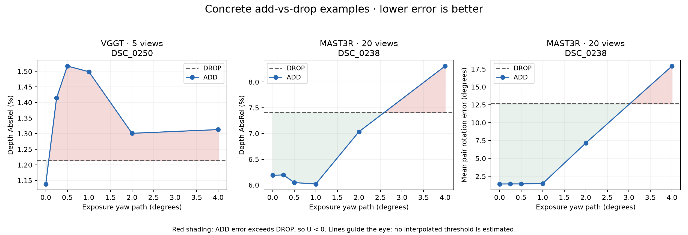
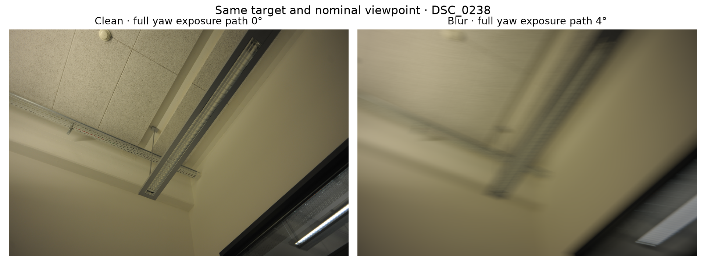
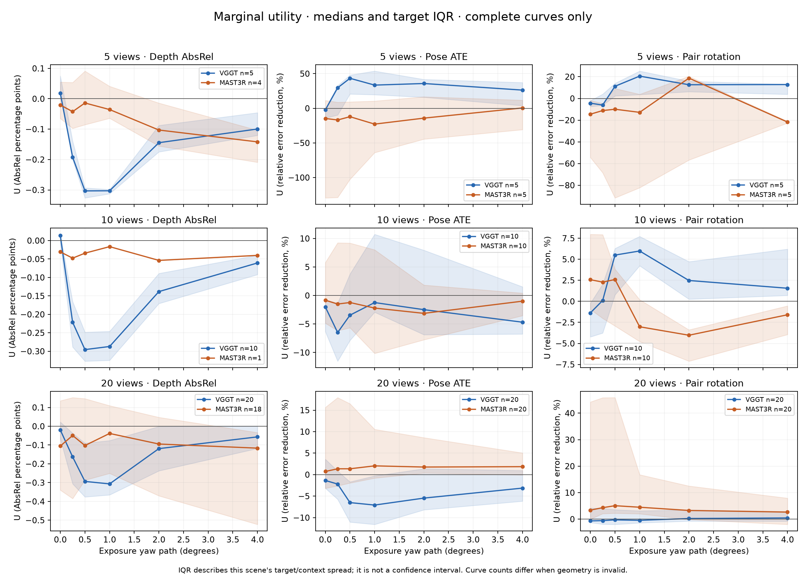
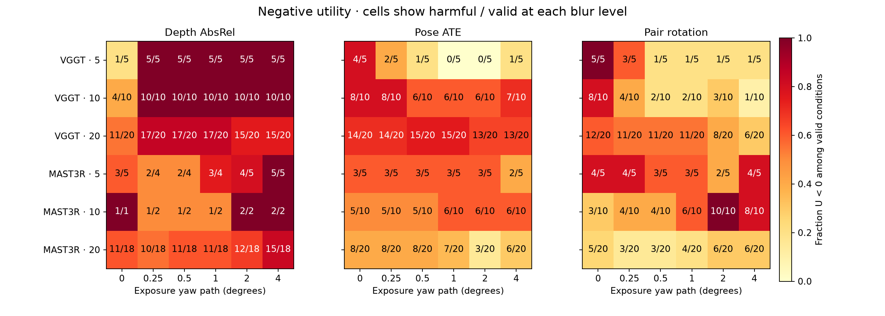

# FrameUtility 결과 분석

분석 대상은 ETH3D `office`의 20개 타깃 이미지, 중첩된 5·10·20장 집합, 6개 회전 blur 단계, VGGT와 MASt3R이다. 총 **420조건, 2,100개 지표 행**을 모두 확인했다. 실행은 2026-10-24 **22:48경(KST)** 종료했다. 입력·가중치·환경 기록과 원본 결과는 그대로 보존했다.

**핵심 결론:** 이 장면에서는 선명할 때 도움이 되던 추가 뷰가 흐려지면 DROP보다 나빠지는 사례가 실제로 나타났다. Depth에서는 비교적 자주 관찰됐고, pose에서는 지표와 컨텍스트에 따라 반응이 달랐다. Blur에 따른 U 감소가 항상 단조로운 것은 아니다.

## 1. 무엇을 측정했는가

- `U_raw = E_DROP − E_ADD`; 양수는 추가 뷰가 도움, 음수는 빼는 편이 좋다는 뜻이다.
- Pose 표와 그래프에서는 `(E_DROP − E_ADD)/E_DROP`를 사용한다. % 표시는 오차 감소율이다.
- Geometry는 scale-aligned depth AbsRel과 RMSE를 각각 계산했다. AbsRel 0.001의 차이는 **0.1 percentage point**에 해당한다.
- ADD와 DROP은 같은 나머지 뷰와 같은 GT 픽셀에서 평가했다. 추가 타깃 자체는 평가 대상에 넣지 않았다. 따라서 결과는 **공통 컨텍스트의 pose/depth 품질에 대한 기여**이며, 타깃만 볼 수 있는 새로운 영역의 completeness를 측정하지 않는다.
- Geometry 참조는 정렬된 ETH3D laser scan의 z-buffer 투영이다. 공식 occlusion 처리를 적용한 ETH3D benchmark 점수는 아니다.
- 본 분석은 `office_fast`의 최종 MPS 결과만 사용한다. 중간 CPU 정렬 결과를 MASt3R 집계에 섞지 않았다. VGGT는 검증된 기존 MPS 결과를 재사용했다.

## 2. 완료와 유효성

| Backend | 전체 조건 | 모든 지표 유효 | Geometry 평가 불가·pose 유효 | 모든 지표 실패 |
|---|---:|---:|---:|---:|
| VGGT | 210 | 210 | 0 | 0 |
| MASt3R | 210 | 146 | 64 | 0 |
| 합계 | 420 | 356 | 64 | 0 |

모든 pose 지표는 계산됐다. MASt3R geometry는 64조건에서 고정 GT 마스크 안의 비양수 깊이 때문에 엄격한 유효성 검사에 걸렸다. 이 조건들은 정상 geometry 점수로 대체하거나 집계에서 숨기지 않았다.

## 3. 가장 명확한 반례: 선명할 때 도움, 흐려지면 해로움

**MASt3R / 20장 집합 / 타깃 `DSC_0238`**. 아래 점수는 타깃을 제외한 동일한 19개 뷰에서 측정했다.

| 지표 — 낮을수록 좋음 | DROP: 타깃 제외 | ADD: clean 타깃 | ADD: 4° blur 타깃 |
|---|---:|---:|---:|
| Depth AbsRel | 7.405% | **6.190%** | **8.310%** |
| Depth RMSE | 0.3695 m | **0.2975 m** | **0.4230 m** |
| Normalized ATE | 0.5656 | **0.3349** | **0.5834** |
| Pair translation relative error | 0.7084 | **0.3264** | **0.7394** |
| Mean pair rotation error | 12.682° | **1.425°** | **17.919°** |

이 사례는 단순히 clean보다 흐린 입력의 성능이 낮다는 비교를 넘는다. **4° blur를 추가한 결과가 아예 그 뷰를 제외한 DROP보다 다섯 지표 모두 나쁘다.** 반대로 clean을 추가하면 다섯 지표 모두 좋아진다.

Pose utility를 비율로 보면 ATE U는 clean **+40.79% → 4° −3.14%**, 회전 U는 **+88.77% → −41.30%**다. Depth AbsRel U는 **+0.012155 → −0.009046**이다.





### 별도 재실행 검증

위 사례의 DROP과 4° ADD를 각각 한 번 더 실행했다. 이미 존재하던 clean 반복 결과와 함께 가능한 원본/반복 조합을 모두 비교했다. **다섯 지표 모두 clean의 U>0, 4°의 U<0가 유지됐다.**

| 지표 | 재실행 조합의 clean U_raw 범위 | 4° U_raw 범위 |
|---|---:|---:|
| Normalized ATE | +0.22942 ~ +0.23074 | −0.01940 ~ −0.01777 |
| Pair translation relative error | +0.38054 ~ +0.38393 | −0.03249 ~ −0.03093 |
| Pair rotation | +11.150° ~ +11.259° | −5.346° ~ −5.237° |
| Depth AbsRel | +0.011928 ~ +0.012462 | −0.009273 ~ −0.008754 |
| Depth RMSE | +0.07135 ~ +0.07221 m | −0.05489 ~ −0.05346 m |

여기서 범위는 두 번의 DROP, 두 번의 clean, 두 번의 4° ADD를 조합한 관측 범위다. 신뢰구간은 아니다. DROP 회전 오차 자체도 재실행에서 약 0.107° 달라졌으므로, clean 반복만으로 모든 조건의 변동을 추정하면 부족할 수 있다. 이 대표 사례의 효과는 그 변동보다 훨씬 컸다. [재실행 원자료](case_repeats/verification.json)

## 4. 전체 곡선에서 전환은 얼마나 자주 나왔는가

각 모델에 35개의 `(집합 크기, 타깃)` 곡선이 있다. 아래 분모는 **6단계 모두 유효하고 clean에서 U>0인 곡선 수**다. 분자는 그중 blur 단계에서 한 번이라도 U<0가 관측된 수다. Clean부터 해로운 곡선은 전환 분모에서 제외했다.

| 지표 | VGGT: clean 유익 → 이후 해로움 | MASt3R: clean 유익 → 이후 해로움 |
|---|---:|---:|
| Depth AbsRel | **17/19** | **7/9** |
| Depth RMSE | **15/17** | **4/6** |
| Normalized ATE | 1/9 | 4/19 |
| Pair translation relative error | 2/11 | 7/19 |
| Pair rotation error | 0/10 | **12/23** |

Geometry의 완전한 곡선은 VGGT 35개, MASt3R 23개다. Pose는 양쪽 모두 35개다. **분모의 조건과 유효 곡선 구성이 달라, 위 비율만으로 모델 우열을 결정할 수 없다.**

### 반복 변동에 대한 민감도

사후 점검으로 양수/음수 판정을 `|U_raw| > 3 × 관측된 clean 반복 오차 차이`로 강화했다. MASt3R에서는 다음과 같이 줄었다.

| 지표 | Raw 부호 전환 | 3× clean 반복 차이 검사 |
|---|---:|---:|
| Depth AbsRel | 7/9 | **5/8** |
| Depth RMSE | 4/6 | 4/5 |
| ATE | 4/19 | 3/18 |
| Pair translation | 7/19 | 6/17 |
| Pair rotation | 12/23 | **11/22** |

분모도 충분한 clean 이득이 관측된 곡선으로 좁아진다. 이 검사는 **3σ 검정이나 통계적 유의성 검정이 아니다.** clean을 두 번 실행한 차이만 사용했으며, 전체 DROP/blur 조건의 분산은 측정하지 않았다. VGGT clean 반복은 이번 환경에서 동일했지만, 이것이 GT 불확실성이나 모든 입력의 변동이 0이라는 뜻은 아니다.

### 작은 효과를 제외하면

원시 부호 전환에는 매우 작은 차이도 포함된다. 예를 들어 VGGT의 clean 양수 U 중 최솟값은 AbsRel 약 0.00000042다. 별도의 사후 점검에서 clean 이득과 이후 손해가 **둘 다** 절대 문턱 ε를 넘도록 요구하면 다음과 같다.

| AbsRel 절대 문턱 ε | VGGT: clean U>ε → 이후 U<−ε | MASt3R: clean U>ε → 이후 U<−ε |
|---|---:|---:|
| 0 | 17/19 | 7/9 |
| 0.0005 (0.05 percentage point) | 5/7 | 5/8 |
| 0.001 (0.1 percentage point) | 2/3 | 5/7 |

이는 미리 정한 실용적 중요도나 유의성 기준이 아니라 효과 크기에 따른 민감도 예시다. 큰 전환도 존재하지만, **17/19 같은 원시 비율을 모두 큰 실용적 개선·악화로 해석하면 안 된다.** [문턱별 원자료](effect_size_sensitivity.json)

## 5. Blur가 커질수록 항상 더 해로운가

**단조 감소 가설을 강하게 지지하지 않는다.**

- VGGT AbsRel에서 clean보다 4° ADD가 나쁜 곡선은 **31/35**였다. 그러나 U가 6단계 내내 감소한 곡선은 **1/35**뿐이었다. 중앙값은 0.5~1°에서 가장 나빴다가 2~4°에서 회복되는 모양이다. 회복돼도 DROP보다 나쁜 사례는 많다.
- VGGT 5장 집합의 ATE U 중앙값은 clean **−2.27% → 4° +26.30%**였다. 같은 실험의 depth U는 나빠졌다. Depth와 pose를 한 점수로 합치면 이 차이를 놓친다.
- MASt3R 10장 집합의 회전 U 중앙값은 clean **+2.58% → 4° −1.60%**였지만, 20장 집합의 중앙값은 **+3.41% → +2.66%**로 여전히 양수였다.



음영은 이 장면 내 타깃·컨텍스트의 사분위 범위다. 신뢰구간이 아니다. MASt3R 10장 geometry의 완전한 곡선은 1개뿐이므로 해당 선으로 일반적인 경향을 주장할 수 없다.



표기된 분수는 각 blur 단계의 `U<0 개수 / 유효한 조건 수`다. 실패 조건은 음수 U로 임의 환산하지 않았다.

## 6. b*에 대해 말할 수 있는 것

- VGGT AbsRel의 관측 전환 17건 중 **16건은 [0°, 0.25°]**, 나머지 1건은 [0.25°, 0.5°]에 첫 부호 전환이 있었다. 현재 ladder로는 0~0.25° 사이를 더 좁혀 말할 수 없다.
- MASt3R AbsRel 전환 7건의 첫 구간은 [0.5°, 1°] 2건, [1°, 2°] 2건, [2°, 4°] 3건이었다. 이는 원시 부호 기준이고 일부 작은 효과는 반복 차이 검사에서 제외된다.
- VGGT AbsRel 전환 곡선 중 3개는 이후 단계에서 다시 양수가 되는 구간도 있었다. 첫 crossing을 단일하고 영구적인 임계값으로 해석하면 안 된다.

따라서 지금의 결과는 **관측된 부호 전환 구간**이다. 보편적 blur 임계값이나 연속적인 정확한 b*를 추정한 결과는 아니다.

## 7. Geometry 평가 불가 64건의 해석

| MASt3R 집합 크기 | Geometry 평가 불가 / 조건 수 |
|---|---:|
| 5장 | 3/30 |
| 10장 | 49/60 |
| 20장 | 12/120 |

64건 중 **60건은 DROP에서도 이미 비양수 깊이가 있었다.** 이는 10개의 실패 DROP 컨텍스트가 각 6개 blur 조건에 반복 연결된 것이다. 유효한 DROP에서 ADD만 검사에 걸린 조건은 4건이다. 따라서 64건을 모두 blur가 만든 실패라고 세면 잘못이다.

실패한 평가 입력을 직접 검사하면 NaN/Inf는 없었고, 고정 GT 마스크에서 비양수 깊이가 64~192픽셀 있었다. 평가 픽셀 중 비율은 약 **0.0024~0.0236%**, 중앙값 약 **0.0056%**였다. 한 픽셀만 비양수여도 geometry 전체를 NA로 만드는 현재 규칙은 이처럼 작은 영역에도 민감하다. 이것은 전체 재구성이 붕괴했다는 뜻과 다르다. Pose는 계속 유효했다.

### 사후 점수 민감도 분석

원본의 엄격한 판정은 보존했다. 별도 점수에서 양수 예측으로 positive median scale을 맞춘 뒤 **같은 전체 GT 마스크**에 음수/0 깊이도 포함해 AbsRel/RMSE 오차를 계산했다. 비정상 픽셀을 평가에서 지우거나 정상값으로 clamp하지 않았다. Nonfinite 예측은 여전히 실패로 남기는 정의다.

이 사후 정의는 원래 유효했던 **712개 geometry 지표 행의 E 값을 정확히 재현**했다. MASt3R은 35곡선 모두에서 비교가 가능해졌고, AbsRel 전환은 **14/17**, clean 반복 차이의 3배 검사에서는 **11/15**였다. RMSE는 6/12, 해당 반복 차이 검사에서는 5/10이었다.

따라서 비양수 픽셀 처리에 따라 분모와 빈도는 달라지지만, **유익한 뷰가 blur 후 해로워지는 현상 자체는 이 사후 검사에서도 남았다.** 이 점수는 결과를 본 뒤 추가한 민감도 분석이며, 원래의 주 지표나 공식 benchmark 점수로 대체하지 않는다. [정의·전체 결과](depth_sensitivity.json), [실패 픽셀 감사](invalid_depth_audit.json)

## 8. 모델과 이미지 수를 비교할 때의 주의점

같은 23개 유효한 완전 곡선만 맞춰 비교하면, 4°에서 AbsRel U가 음수인 수는 **VGGT와 MASt3R 모두 20/23**이었다. 0.25°에서는 VGGT 20/23, MASt3R 13/23이었다. 이는 이 유효 부분집합의 묘사이며, MASt3R의 누락된 geometry 조건과 모델별 baseline 정확도까지 포함한 우열 판정은 아니다.

5·10·20은 뷰 개수뿐 아니라 구성이 다르다. 작은 집합은 GT overlap을 높게 유지하도록 선정됐고, 20장에는 넓은 회전·서로 덜 겹치는 뷰가 들어 있다.

| 집합 | 평균 pair visibility overlap | Pair 회전의 중앙값 |
|---|---:|---:|
| 5장 | 0.626 | 19.5° |
| 10장 | 0.443 | 35.7° |
| 20장 | 0.187 | 74.8° |

35개 타깃·컨텍스트 곡선은 단일 장면의 20개 이미지에서 중첩된다. 이를 35개의 독립 장면처럼 다루지 않았으며, 모집단 신뢰구간이나 p-value를 제시하지 않는다. 양쪽은 같은 준비 이미지와 blur 처리를 받지만 native resize/crop은 VGGT 518px, MASt3R 512px로 다르다.

## 9. 이번 결과로 가능한 주장과 다음 우선순위

지금 지지되는 주장은 다음 범위다.

> ETH3D office의 고정된 관측 집합에서, 기하학적으로 유효한 추가 뷰가 선명할 때는 공통 컨텍스트의 재구성 오차를 줄이고, 충분히 흐려지면 그 뷰를 제외하는 것보다 오차를 키우는 사례가 있다. 그 전환은 metric과 context에 의존한다.

이를 보편적인 프레임 제거 규칙, 모델 전체의 우열, 모든 pose/geometry 지표의 단조 악화, 전체 장면 completeness의 감소로 확대할 근거는 부족하다.

다음 실험은 다음 순서가 타당하다.

1. **VGGT의 0~0.25°를 더 촘촘히 샘플링.** 대부분의 첫 전환이 첫 구간에 몰려 있다. 동일한 resampling을 거친 zero-motion control도 함께 확인한다.
2. **DROP과 전환 전후 ADD 반복을 확대.** 대표 사례에서는 재현됐지만, 다른 곡선의 작은 부호 변화까지 안정적이라고 보장하지 못한다.
3. **엄격한 geometry 유효성·비양수 픽셀 비율·전체 고정 마스크 점수를 함께 보고.** 후속 실험 전에 주 지표와 실패 판정을 고정한다.
4. **이미 내려받은 다른 장면으로 확장.** 다른 overlap/texture/회전 조건에서도 같은 현상이 남는지 확인한 뒤 장면 단위로 통계를 요약한다.

## 재현과 파일

- [원본 결과 CSV](../utilities.csv), [입력 manifest](../inputs.json)
- [전체 집계·곡선·반복 차이 검사](summary.json)
- [사후 depth 민감도 분석](depth_sensitivity.json)
- [대표 사례 재실행 검증](case_repeats/verification.json)
- [SVG 그림](counterfactual_examples.svg)

재생성 명령:

```sh
.venv/bin/python experiments/analyze_results.py
.venv/bin/python experiments/analyze_depth_sensitivity.py
```

대표 사례의 추가 추론 검증은 `experiments/verify_result_case.py`로 별도로 수행했다. 분석 중 원본 420조건의 점수는 수정하지 않았다.
