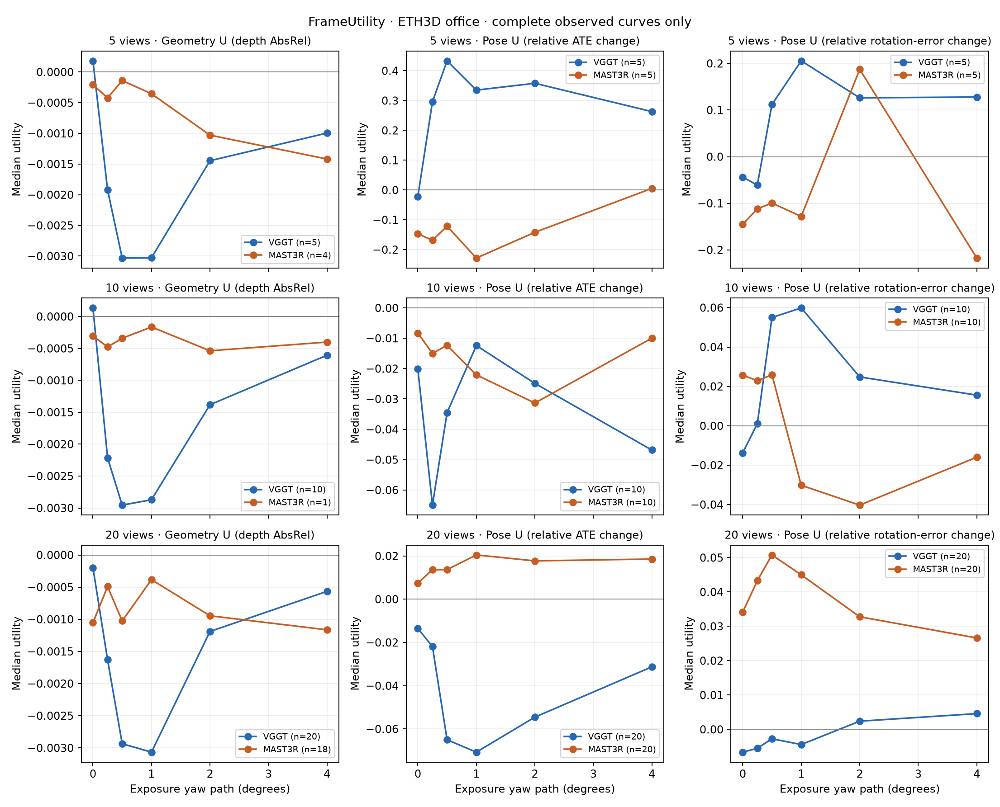

# FrameUtility 실험 결과

갱신: 2026-10-24T13:48:55+00:00

평가한 ADD/DROP 조건: **420/420**. 모든 지표 정상 356개, 일부 지표 실패 64개, 모든 지표 실패 0개.

조건마다 pose 3개와 geometry 2개 지표를 별도로 계산한다. 잘못된 깊이는 geometry 실패로 기록하며, 유효한 pose 결과는 유지한다.

ETH3D office 한 장면의 탐색 실험이다. 입력/GT/checksum은 `inputs.json`, 장비·버전·가중치는 각 backend의 `environment.json`에 있다.

| Backend | 이미지 수 | 평가한 조건 / 계획 | 모든 지표 정상 | 일부 실패 | 모두 실패 |
|---|---:|---:|---:|---:|---:|
| vggt | 5 | 30/30 | 30 | 0 | 0 |
| vggt | 10 | 60/60 | 60 | 0 | 0 |
| vggt | 20 | 120/120 | 120 | 0 | 0 |
| mast3r | 5 | 30/30 | 27 | 3 | 0 |
| mast3r | 10 | 60/60 | 11 | 49 | 0 |
| mast3r | 20 | 120/120 | 108 | 12 | 0 |

그림과 aggregate 통계는 6단계가 모두 관측된 타깃 곡선만 사용한다. 진행 중인 조건도 전체 `utilities.csv`에는 보존된다.

## 첫 타깃의 5장 결과

Geometry U는 depth AbsRel의 원래 차이이다. Pose U는 DROP 대비 오차 감소율(%)이며, 음수면 해당 지표에서 추가 뷰가 해롭다.

| Backend | Target | Blur 경로 (°) | Geometry U | Pose ATE U (%) | Pose rotation U (%) |
|---|---|---:|---:|---:|---:|
| vggt | DSC_0219 | 0 | -0.000092 | -0.974015 | -4.380946 |
| vggt | DSC_0219 | 0.25 | -0.001922 | 52.915065 | -6.106813 |
| vggt | DSC_0219 | 0.5 | -0.003263 | 52.807327 | -2.545126 |
| vggt | DSC_0219 | 1 | -0.003028 | 33.506605 | -5.339766 |
| vggt | DSC_0219 | 2 | -0.001747 | 35.801459 | -4.399678 |
| vggt | DSC_0219 | 4 | -0.001331 | 54.324274 | -20.089554 |
| mast3r | DSC_0219 | 0 | 0.001625 | -129.399305 | -14.532366 |
| mast3r | DSC_0219 | 0.25 | 0.001873 | -128.758626 | -4.672096 |
| mast3r | DSC_0219 | 0.5 | 0.001977 | -102.537325 | 9.168308 |
| mast3r | DSC_0219 | 1 | 0.002274 | -63.997942 | 19.985313 |
| mast3r | DSC_0219 | 2 | 0.001700 | -14.195936 | 20.420902 |
| mast3r | DSC_0219 | 4 | -0.001490 | -100.669136 | -21.752374 |

## 검증과 해석 범위

- clean 반복 결과는 각 backend의 `repeatability.json`에 기록한다. 반복 오차보다 작은 변화에는 의미를 부여하지 않는다.
- Clean에서 이미 U<0인 조건은 처음부터 해로운 뷰로 분리한다. 이를 blur 때문에 양수에서 음수로 전환된 사례로 세지 않는다.
- Geometry 참조는 정렬된 laser scan의 z-buffer 투영이다. 공식 ETH3D occlusion 처리를 포함하지 않으며, 공식 benchmark 점수가 아니다.
- 두 backend는 같은 이미지 집합과 회전 노출 경로를 받는다. GT는 blur 생성·선정·평가에만 사용한다.
- 한 장면의 일부 관측으로 일반적인 임계 blur나 모델 우열을 결론 내릴 수 없다.

실행·CUDA 이전 방법: [실험 실행 문서](../../experiments/README.md).
