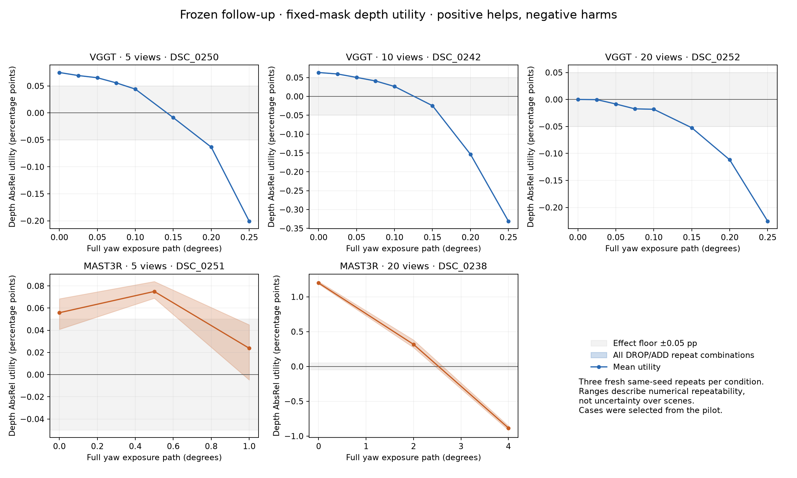

# 평가 기준 고정·0° 대조군·전환 반복 검증

프로토콜 고정 시각: 2026-10-24T18:31:48.852844+00:00. 원래 420조건과 후속 결과를 분리했다. 새 재구성 **105/105회**: 정상 105 · 부분 유효 0 · 실패 0.

## 1. 실행 전에 고정한 평가 기준

주 지표는 공통 컨텍스트의 scale-aligned depth AbsRel이다. 타깃을 제외한 동일 GT 마스크 전체에서 오차를 계산한다. 전체 컨텍스트의 양수 예측에서 median(GT/prediction)으로 하나의 scale을 맞춘 뒤, 유한한 음수·0 깊이도 오차에 포함한다. 평가 픽셀의 NaN/Inf는 geometry 실패로 남긴다. 비양수·비유한 픽셀 비율과 기존 엄격 점수도 함께 보존한다. Pose는 독립 평가한다.

GT는 정렬된 ETH3D laser scan을 nearest-depth z-buffer로 투영한 탐색용 참조다. 공식 occlusion mask를 적용한 ETH3D benchmark 점수나 장면 전체 completeness를 측정하는 지표는 아니다.

AbsRel 효과 문턱은 ε=0.0005 (= 0.05 percentage point)로 실행 전에 고정했다. 파일럿에서 얻은 정보를 참고한 문턱이며 통계적 유의성 기준은 아니다. 보조 지표는 RMSE와 포즈 3종이다.

기존 데이터로 구현을 감사한 결과, 원래 유효했던 **712개 geometry 지표 행의 E 값은 정확히 일치**했다. 원래 평가 불가였던 128개 지표 행(64조건)은 별도 사후 재평가로 남겼다. 새 규칙에서 기존 420조건 모두 깊이 평가가 가능했다. 원본 점수는 수정하지 않았다.

## 2. 0° 처리 대조군

20장 모두 clean의 단축 경로를 우회해 33개 항등 homography, 선형 radiance 적분, sRGB 복원·양자화와 동일 crop을 거쳤다. **변경된 픽셀 0개**였으며, PNG 파일 해시도 모두 일치했다. 입력이 정확히 같으므로 추론에서는 clean 조건과 합쳤다.

이 검사는 0° fast path와 일반 처리 경로의 불일치를 배제한다. 비영 회전의 보간 효과와 실제 노출 적분 효과를 독립적으로 분리한 대조군은 아니다.

## 3. 반복 설계와 주 지표 결과

파일럿에서 고른 다섯 컨텍스트의 각 조건을 3회씩 새로 재구성했다. 이전 결과를 새 반복 횟수에 포함하지 않았다. Seed는 매번 2026이다. MASt3R pair cache는 반복 블록마다 새로 만들고 같은 블록 안에서만 pair 추론을 재사용했다. 모든 ADD/DROP의 정렬은 매번 새로 수행했다. 관측 범위는 같은 seed에서의 수치적 반복성이며 장면 모집단의 불확실성이 아니다.

U 범위는 **DROP 3회 × ADD 3회의 9개 조합**이다. 모든 clean 조합이 양수이고 이후 모든 조합이 음수일 때 안정적 원시 전환으로 판정한다. 효과 문턱 판정은 각각 +ε와 −ε를 넘어야 한다.

| Backend / 컨텍스트 | Clean U 범위 (AbsRel pp) | 원시 부호 전환 구간 | 효과 문턱을 넘는 관측 구간 |
|---|---:|---|---|
| VGGT / 5장 / DSC_0250 | +0.07489 ~ +0.07489 | [0.1°, 0.15°] | [0.075°, 0.2°] |
| VGGT / 10장 / DSC_0242 | +0.06338 ~ +0.06338 | [0.1°, 0.15°] | [0.05°, 0.2°] |
| VGGT / 20장 / DSC_0252 | +0.00004 ~ +0.00004 | [0°, 0.025°] | 확인 안 됨 |
| MAST3R / 5장 / DSC_0251 | +0.04081 ~ +0.06841 | 확인 안 됨 | 확인 안 됨 |
| MAST3R / 20장 / DSC_0238 | +1.18510 ~ +1.22106 | [2°, 4°] | [2°, 4°] |

구간은 관측된 안정적 양수 단계와 첫 안정적 음수 단계 사이를 뜻한다. 효과 문턱 열에서는 양쪽 효과가 각각 문턱을 넘어야 한다. 중간 단계에 반복 간 부호 혼합이나 작은 효과가 있으면 구간이 넓어진다. 단조성을 가정하거나 보간으로 정확한 연속 임계값을 추정하지 않았다.

### 결과 해석

- **VGGT 5장 / DSC_0250:** 원시 전환 [0.1°, 0.15°]이 재현됐고 효과 문턱도 통과했다.
- **VGGT 10장 / DSC_0242:** 원시 전환 [0.1°, 0.15°]이 재현됐고 효과 문턱도 통과했다.
- **VGGT 20장 / DSC_0252:** 원시 부호 전환은 재현됐지만 clean 이득과 blur 손해가 모두 문턱을 넘는 전환은 확인되지 않았다. 작은 원시 부호를 큰 효과로 해석하면 안 된다.
- **MAST3R 5장 / DSC_0251:** 선택한 구간에서 안정적인 AbsRel 전환이 확인되지 않았다. 마지막 단계 U 범위는 -0.00474 ~ +0.04493 pp다.
- **MAST3R 20장 / DSC_0238:** 원시 전환 [2°, 4°]이 재현됐고 효과 문턱도 통과했다.

### 큰 MASt3R 사례의 새 반복 평균

20장 / DSC_0238의 다섯 지표 모두에서 clean 이득과 4° 손해가 모든 반복 조합에 걸쳐 유지됐다. 아래는 각 조건의 새 반복 3회 평균이며, 모두 낮을수록 좋다.

| 지표 | DROP | Clean ADD | 4° ADD | 4° U_raw 범위 |
|---|---:|---:|---:|---:|
| Depth AbsRel (%) | 7.37501 | 6.17604 | 8.25833 | -0.91397 ~ -0.85285 |
| Depth RMSE (m) | 0.36945 | 0.29735 | 0.42216 | -0.05419 ~ -0.05098 |
| Normalized ATE | 0.56516 | 0.33504 | 0.58348 | -0.01901 ~ -0.01751 |
| Pair translation relative | 0.70739 | 0.32649 | 0.73907 | -0.03291 ~ -0.02994 |
| Pair rotation (°) | 12.55280 | 1.41750 | 17.90876 | -5.40798 ~ -5.31598 |

AbsRel 행의 U 범위 단위는 percentage point이며, 나머지는 각 지표의 원래 단위다.

### 단계별 깊이 utility

| Backend / 컨텍스트 | Blur | U 범위 (AbsRel pp) | 유효 DROP / ADD 반복 | 판정 |
|---|---:|---:|---:|---|
| VGGT / 5 / DSC_0250 | 0° | +0.07489 ~ +0.07489 | 3 / 3 | 도움, 문턱 초과 |
| VGGT / 5 / DSC_0250 | 0.025° | +0.06925 ~ +0.06925 | 3 / 3 | 도움, 문턱 초과 |
| VGGT / 5 / DSC_0250 | 0.05° | +0.06518 ~ +0.06518 | 3 / 3 | 도움, 문턱 초과 |
| VGGT / 5 / DSC_0250 | 0.075° | +0.05562 ~ +0.05562 | 3 / 3 | 도움, 문턱 초과 |
| VGGT / 5 / DSC_0250 | 0.1° | +0.04414 ~ +0.04414 | 3 / 3 | 양수, 일부 문턱 이하 |
| VGGT / 5 / DSC_0250 | 0.15° | -0.00878 ~ -0.00878 | 3 / 3 | 음수, 일부 문턱 이하 |
| VGGT / 5 / DSC_0250 | 0.2° | -0.06343 ~ -0.06343 | 3 / 3 | 해로움, 문턱 초과 |
| VGGT / 5 / DSC_0250 | 0.25° | -0.20072 ~ -0.20072 | 3 / 3 | 해로움, 문턱 초과 |
| VGGT / 10 / DSC_0242 | 0° | +0.06338 ~ +0.06338 | 3 / 3 | 도움, 문턱 초과 |
| VGGT / 10 / DSC_0242 | 0.025° | +0.05944 ~ +0.05944 | 3 / 3 | 도움, 문턱 초과 |
| VGGT / 10 / DSC_0242 | 0.05° | +0.05040 ~ +0.05040 | 3 / 3 | 도움, 문턱 초과 |
| VGGT / 10 / DSC_0242 | 0.075° | +0.04096 ~ +0.04096 | 3 / 3 | 양수, 일부 문턱 이하 |
| VGGT / 10 / DSC_0242 | 0.1° | +0.02633 ~ +0.02633 | 3 / 3 | 양수, 일부 문턱 이하 |
| VGGT / 10 / DSC_0242 | 0.15° | -0.02465 ~ -0.02465 | 3 / 3 | 음수, 일부 문턱 이하 |
| VGGT / 10 / DSC_0242 | 0.2° | -0.15343 ~ -0.15343 | 3 / 3 | 해로움, 문턱 초과 |
| VGGT / 10 / DSC_0242 | 0.25° | -0.33081 ~ -0.33081 | 3 / 3 | 해로움, 문턱 초과 |
| VGGT / 20 / DSC_0252 | 0° | +0.00004 ~ +0.00004 | 3 / 3 | 양수, 일부 문턱 이하 |
| VGGT / 20 / DSC_0252 | 0.025° | -0.00027 ~ -0.00027 | 3 / 3 | 음수, 일부 문턱 이하 |
| VGGT / 20 / DSC_0252 | 0.05° | -0.00835 ~ -0.00835 | 3 / 3 | 음수, 일부 문턱 이하 |
| VGGT / 20 / DSC_0252 | 0.075° | -0.01731 ~ -0.01731 | 3 / 3 | 음수, 일부 문턱 이하 |
| VGGT / 20 / DSC_0252 | 0.1° | -0.01815 ~ -0.01815 | 3 / 3 | 음수, 일부 문턱 이하 |
| VGGT / 20 / DSC_0252 | 0.15° | -0.05236 ~ -0.05236 | 3 / 3 | 해로움, 문턱 초과 |
| VGGT / 20 / DSC_0252 | 0.2° | -0.11176 ~ -0.11176 | 3 / 3 | 해로움, 문턱 초과 |
| VGGT / 20 / DSC_0252 | 0.25° | -0.22547 ~ -0.22547 | 3 / 3 | 해로움, 문턱 초과 |
| MAST3R / 5 / DSC_0251 | 0° | +0.04081 ~ +0.06841 | 3 / 3 | 양수, 일부 문턱 이하 |
| MAST3R / 5 / DSC_0251 | 0.5° | +0.06888 ~ +0.08399 | 3 / 3 | 도움, 문턱 초과 |
| MAST3R / 5 / DSC_0251 | 1° | -0.00474 ~ +0.04493 | 3 / 3 | 반복 간 부호 혼합 |
| MAST3R / 20 / DSC_0238 | 0° | +1.18510 ~ +1.22106 | 3 / 3 | 도움, 문턱 초과 |
| MAST3R / 20 / DSC_0238 | 2° | +0.27162 ~ +0.38100 | 3 / 3 | 도움, 문턱 초과 |
| MAST3R / 20 / DSC_0238 | 4° | -0.91397 ~ -0.85285 | 3 / 3 | 해로움, 문턱 초과 |

## 4. 보조 지표의 안정적 원시 전환

| 컨텍스트 | RMSE | 정규화 ATE | Pair translation | Pair rotation |
|---|---|---|---|---|
| VGGT / 5 / DSC_0250 | [0.075°, 0.1°] | 확인 안 됨 | 확인 안 됨 | 확인 안 됨 |
| VGGT / 10 / DSC_0242 | [0.1°, 0.15°] | 확인 안 됨 | 확인 안 됨 | 확인 안 됨 |
| VGGT / 20 / DSC_0252 | [0.05°, 0.075°] | 확인 안 됨 | 확인 안 됨 | 확인 안 됨 |
| MAST3R / 5 / DSC_0251 | [0.5°, 1°] | 확인 안 됨 | 확인 안 됨 | [0.5°, 1°] |
| MAST3R / 20 / DSC_0238 | [2°, 4°] | [2°, 4°] | [2°, 4°] | [2°, 4°] |

## 5. 유효성과 해석 범위

새 재구성 중 비양수 깊이가 관측된 결과는 0개이며 고정 마스크 내 최대 비율은 0.000000%였다. 각 결과 JSON에는 기존 엄격 평가의 실패 여부도 기록돼 있다.

새 재구성 105개 중 **105개의 모든 평가 값·실패 상태가 기존 엄격 평가와 정확히 일치**했다. 이번 선정 사례에서 확인된 전환은 새 깊이 처리 규칙으로 점수를 바꿔 만든 결과가 아니다.

사례 선정과 효과 문턱은 탐색 결과의 영향을 받았다. 이번 실험은 그 사례의 대조군과 수치적 반복성을 검증한다. 모집단의 전환 빈도, 모델 우열, 보편적 blur 임계값을 추정하지 않는다. 단일 office 장면이며 컨텍스트가 중첩된다. 원시 부호 전환과 효과 문턱을 넘는 전환을 구분해야 한다.

다음 확장은 다른 장면에서 같은 평가 정책을 고정해 검증하는 것이다. 새 장면은 이번 파일럿 선정 사례와 분리해 집계해야 한다.

## 파일과 재현

- [고정 프로토콜](protocol.json), [읽기용 프로토콜과 실행 명령](protocol.md)
- [기존 데이터의 평가 정책 감사](policy_audit.json)
- [반복별 전체 지표 CSV](utilities.csv), [집계와 모든 관측 구간](summary.json)
- [최종 무결성 검증](verification.json)
- [SVG 그림](depth_repeat_ranges.svg), [고정 소스 보관본](source/followup.py)

재생성: .venv/bin/python experiments/analyze_followup.py
